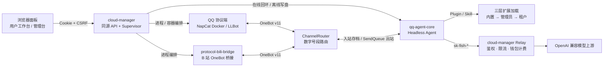

# 技术开发指南

本文面向参与功能开发或二次定制的开发者，帮助你快速定位代码、运行调试和完成验证。模块级接口细则见 `docs/` 下各专题文档。

## 1. 目录结构

```text
fish/
├── .tools/node/                       # 仓库内置便携 Node 24（Windows 开发环境）
├── deploy/napcat/                     # NapCat Docker 镜像预检脚本与部署说明
├── docs/                              # 协议、云端 API、扩展、测试与部署文档
├── packages/
│   ├── cloud-manager/
│   │   ├── src/                       # 多租户管理 API、Supervisor、Relay 计费、Gateway
│   │   └── panel/                     # 零构建原生 ESM 前端（用户工作台 + 管理员后台）
│   ├── qq-agent-core/
│   │   ├── src/                       # Agent 对话编排、双通道路由、发送队列、记忆、配置编解码
│   │   ├── modules/headless/          # Linux / 云端无头运行入口
│   │   ├── plugins/ & skills/         # 内置确定性插件与 LLM 工具技能
│   │   └── ui/ & electron/            # 单机版控制台与桌面壳
│   ├── protocol-bili-bridge/          # B 站评论/动态/私信/直播 → OneBot v11 桥接服务
│   └── protocol-qq-llbot/             # LLBot QQ 协议实现（TypeScript + Yarn 4）
├── scripts/                           # 根目录检查与串联测试脚本
└── var/                               # 本地运行数据目录（自动生成，不入库）
```

> 各包**不自动读取 `.env` 文件**，所有环境变量需在启动终端或进程管理器中显式传入。

## 2. 总体架构与核心原则



开发时需遵守以下 5 条架构边界：

1. **入口隔离路由**：`ChannelRouter` 按数字号段区分 QQ 协议、B 站和桌宠，并按专用字符串 ID 路由 QQ 官方 Bot；具体范围见[协议说明](docs/protocols.md)。目标异常或通道未启用时直接报错，**绝不跨平台回退**。
2. **统一出站队列**：所有发送动作必须经过 `SendQueue`（白名单校验 → 平台能力校验 → `send.guard` 插件链 → 频控），扩展不得直接调底层协议发消息。
3. **同源在线/离线双模配置**：面板统一调用 `/api/tenants/:id/agent/*`；`AgentSettingsService` 复用核心 `config-codec.js` 与 `config-guard.js`，实例离线可安全写盘预配，在线则经本地回环热同步且锁死云管字段（如空白名单禁放行、锁定 `server`/`channels`、零明文密钥回显）。
4. **三层扩展与管理员管控**：扩展按“内置 → 管理员安装（`admin-extensions/`）→ 已声明隔离的租户目录”加载；管理员可通过面板上传/分发插件或用 `blocked-extensions.json` 按实例屏蔽内置扩展，普通用户仅可开关已开放扩展及修改安全参数。
5. **进程就绪校验**：云端启动 Agent 时通过 Node IPC 等待子进程回报 `{ type: "fish-agent-listening", pid, port }` 后再探测 TCP，避免端口抢占误判；若自定义 `CLOUD_AGENT_ENTRY` 必须兼容该回执。

## 3. 日常开发命令

新开终端先启用 Node 24：`export PATH="$PWD/.tools/node:$PATH"`。

| 场景 | 执行目录 | 命令 |
|---|---|---|
| 启动云端管理与面板 | 仓库根目录 | `npm start` |
| 全仓脚本契约检查 | 仓库根目录 | `npm run check` |
| 云端后端测试 | `packages/cloud-manager` | `npm test` |
| 云端前端面板测试 | `packages/cloud-manager` | `npm --prefix panel test` |
| Agent 核心无头启动 | `packages/qq-agent-core` | `QQ_AGENT_TOKEN=dev npm run server:headless` |
| Agent 核心主测试 / 覆盖测试 | `packages/qq-agent-core` | `npm test` / `npm run test:coverage` |
| Agent 新建技能脚手架 | `packages/qq-agent-core` | `npm run new:skill <skill-id>` |
| B 站桥接检查与测试 | `packages/protocol-bili-bridge` | `npm run check && npm test` |
| LLBot 类型检查、测试与构建 | 仓库根目录 | `npm run llbot:check && npm run llbot:test && npm run llbot:build` |

> **说明**：`qq-agent-core` 的完整 `npm test` 包含桌面端本地便携 QQ/SnowLuma 安装检查（`setup-qq-version.mjs`）。在未安装桌面组件的机器上，可运行 `npm run test:coverage`、`npm run test:headless` 或直接 `node test/<具体测试>.mjs` 验证核心逻辑。

## 4. 代码修改地图（改哪里、测什么）

以下路径均相对于 `packages/`：

| 你想修改的功能 | 核心文件位置 | 必跑关联测试 |
|---|---|---|
| **QQ / B 站路由与动作白名单** | `qq-agent-core/src/channel-router.js`、`onebot.js` | `qq-agent-core/test/channel-router-test.mjs` |
| **发送队列、白名单与防刷屏守卫** | `qq-agent-core/src/sender.js` | `qq-agent-core/test/send-guard-test.mjs` |
| **入站消息编排、唤醒档位与提示词** | `qq-agent-core/src/{app,orchestrator,prompt}.js` | `qq-agent-core/test/{wake-semantics-test,test-prompt,final-integration-test}.mjs` |
| **默认配置项与配置脱敏/合并** | `qq-agent-core/src/{config-defaults,config-codec}.js`、`cloud-manager/src/config-guard.js` | `qq-agent-core/test/config-extension-foundation.test.mjs`、`cloud-manager/test/view-api-backend.test.mjs` |
| **人设模板与 SillyTavern 角色卡** | `qq-agent-core/src/personas.js` | `qq-agent-core/test/persona-card-test.mjs` |
| **插件/技能加载器与 ZIP 安装** | `qq-agent-core/src/{plugin-loader,extension-install}.js`、`skills/{manifest,manager}.js` | `qq-agent-core/test/{extensions-test,extensions-cloud-test,zip-install-security-test}.mjs` |
| **B 站事件轮询、虚拟 ID 与接口** | `protocol-bili-bridge/src/{bridge,mapping/ids,onebot/actions,bili/*}.js` | `protocol-bili-bridge` 下 `npm test` |
| **LLBot 登录授权与协议逻辑** | `protocol-qq-llbot/src/main/qqProtocol/direct.ts`、`webui/BE/routes/*` | `npm run llbot:check && npm run llbot:test` |
| **云端 HTTP API 与权限校验** | `cloud-manager/src/routes/*.js`、`contracts/http.js`、`presenters/tenant-presenter.js` | `cloud-manager/test/{api,view-api-http,user-tenant-permissions}.test.mjs` |
| **云端同源 Agent 设置与扩展分发** | `cloud-manager/src/{agent-settings,extension-service}.js` | `cloud-manager/test/{agent-extensions-view-api,view-api-gateway}.test.mjs` |
| **租户进程、NapCat 容器与内核切换** | `cloud-manager/src/{supervisor,agent-runtime,qq-service,bili-service}.js`、`qq/{napcat,llbot,switch}.js` | `cloud-manager/test/{lifecycle,supervisor-readiness,napcat-runtime,qq-switch-api}.test.mjs` |
| **Relay 模型转发、限流与钱包计费** | `cloud-manager/src/relay/{server,custom-upstreams}.js`、`{billing,plans,pricing}.js` | `cloud-manager/test/relay.test.mjs` |
| **Web 前端面板（用户台 / 管理台）** | `cloud-manager/panel/{app.js,lib/*,components/*,views/user/*,views/admin/*}` | `cloud-manager/panel` 下 `npm test` |

### 4.1 前端面板路由与组件结构（`packages/cloud-manager/panel`）

面板基于原生 ES Modules 与哈希路由（`lib/router.js`），无需打包构建，按角色分为两套视图并共享核心组件：

- **普通用户工作台（默认 `#/user/instances`）**：
  - `#/user/instances`（`views/user/instances.js`）：实例列表与 4 步开通就绪度向导
  - `#/user/instances/:id?tab=overview|whitelist|persona|behavior|runtime`（`views/user/instance.js`）：单实例 5 页签工作台
  - `#/user/{agent,channel,logs,billing}`：快捷 Agent 设置、模型渠道探测、调用日志、钱包充值与续费
- **管理员控制台（默认 `#/admin/overview`，侧栏底部可一键切换至用户视角）**：
  - `#/admin/{overview,extensions,recharges,platform,audit}`：运营总览、公共插件中心、充值审核、平台上游/LLBot 授权与驱动预检、全局审计
  - `#/tenants` 与 `#/tenants/:id/{hosting,agent,extensions,relay,ops}`：租户列表与单实例 5 分区管理中心
  - `#/users` 与 `#/users/:userId/instances`：用户全生命周期管理与名下实例托管
- **共享业务组件（`components/`）**：`agent-studio/`（白名单、人设/角色卡、响应档位、工具能力、会话记忆 5 个编辑器）、`qq-panel.js`、`bili-panel.js`、`extension-manager.js`、`tabs.js`。

## 5. 开发与提交自检清单

1. **先跑单包再跑跨包**：修改涉及协议动作、配置字段或 API 返回结构时，同时运行提供方与消费方测试（如核心 + 云端 + 面板）。
2. **严守配置脱敏契约**：任何新增配置或 API 返回值绝不输出明文 `apiKey`、`token`、`cookie`；在 `config-codec.js` 中敏感字段必须**直接删除键名并补充 `has<Key>: boolean`**（切勿置为空字符串 `""`，否则前端回传配置补丁时会把已保存密钥覆盖清空）。
3. **新增模型或配置需过守卫**：新增平台模型须同步 `cloud-manager/src/plans.js`；新增核心配置若允许云端用户修改，须核对 `config-guard.js`。
4. **前端防 XSS 与零构建**：`panel/` 保持原生 ES Modules，渲染用户输入、群名、日志和报错文本一律使用 DOM 文本节点而非未转义的 `innerHTML`。
5. **扩展资源可回收**：编写插件或技能时，在 `deactivate` / `dispose` 中清理定时器与监听器，确保禁用或热重载后无残留。
6. **文档与实现同步**：修改环境变量、API 路径、默认值或脚本命令后，同步更新对应文档。
