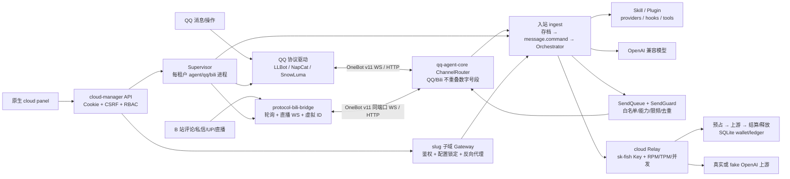

# 开发总览

本文是二次开发入口。契约细节分别见 [协议](docs/protocols.md)、[云端](docs/cloud-manager.md)、[扩展](docs/extensions.md) 和 [测试](docs/testing.md)。NapCat P1 本地实现不代表真实 VPS 或 QQ 验收；P2 完整切换事务和 P3 全量恢复仍待实现。所有说明以当前源码为准；修改实现后必须同步更新对应文档和测试。

## 1. 仓库与运行边界

```text
E:/bigPeach/fish/
├── .tools/node/                       便携 Node 24
├── packages/
│   ├── qq-agent-core/                 Agent、OneBot 双通道、控制台、扩展
│   ├── protocol-qq-llbot/             LLBot Direct/PMHQ、OneBot/Satori/Milky、WebUI
│   ├── protocol-bili-bridge/          B 站 API/直播 → OneBot v11 + admin API
│   └── cloud-manager/
│       ├── src/                       多租户管理、网关、Relay、计费、进程守护
│       └── panel/                     原生 JS 静态面板（无构建）
├── var/                               建议的运行数据根（由配置创建，不是源码）
└── docs/                              开发与协议文档
```

根目录不是 npm workspace，但提供 `npm test`、`npm run test:all` 和 `npm run check`；各包仍独立安装、测试和构建。开发命令统一先执行：

```bash
export PATH="/e/bigPeach/fish/.tools/node:$PATH"
```

不全局安装依赖，不把运行数据、真实凭据或生成产物当作源码编辑。

## 2. 各包标准命令

### 2.1 `packages/qq-agent-core`

| 命令 | 实际用途 |
|---|---|
| `npm start` | Electron 桌面端，入口 `electron/main.js`。 |
| `npm run server` | 原控制台入口 `src/server.js`。 |
| `npm run server:headless` | 已合并的 headless 入口 `modules/headless/server.js`；复用核心双通道路由，协议进程独立管理。 |
| `npm run setup` / `npm run setup:check` | 安装或检查便携 QQ/SnowLuma。 |
| `npm run setup:napcat` | NapCat 安装引导。 |
| `npm test` | 主测试链，包含双通道、角色卡、扩展和最终集成测试。 |
| `npm run test:coverage` | offline/http/e2e/ui/wiring 五组补充覆盖。 |
| `npm run test:all` | `npm test` 加补充覆盖。 |
| `npm run test:skill` / `test:audit` | Skill 架构与工具清单审计。 |
| `npm run test:whitelist` / `test:sticker` / `test:msgid` | 白名单、表情、消息 ID 专项。 |
| `npm run test:prompt` / `test:render` / `test:scroll` / `test:usage` | 提示词和 UI/用量专项。 |
| `npm run test:wiring` / `test:wakesem` | 接线和唤醒语义专项。 |
| `npm run test:setuppin` / `test:download` / `test:qqpack` / `test:qqproc` | 安装、下载、打包和进程专项。 |
| `npm run test:safefile` / `test:sender` | 安全下载和发送专项。 |
| `npm run check:protocol` / `check:judge` / `check:load` | 协议、评审用例和预加载检查。 |
| `npm run new:skill` / `pack:qq` | 新建 Skill 模板、打包便携 QQ。 |

核心声明 `node >=20`，本仓库统一使用便携 Node 24。

### 2.2 `packages/protocol-bili-bridge`

| 命令 | 实际用途 |
|---|---|
| `npm start` | `node src/main.js`，输出一行 ready JSON，日志走 stderr。 |
| `npm test` | 全部 `test/*.test.mjs`，使用 Node 内置 test runner。 |
| `npm run test:unit` | WBI、认证和虚拟 ID 映射专项。 |
| `npm run check` | 对入口、桥接和 OneBot 服务执行 `node --check`。 |

要求 Node `>=24`。独立默认端口是 `36501`，HTTP/WS/admin 同端口。

### 2.3 `packages/protocol-qq-llbot`

| 命令 | 实际用途 |
|---|---|
| `npm run dev` | `tsx watch src/main/main.ts`。 |
| `npm run build` | Vite 构建 `dist/llbot.js` 并复制运行资源。 |
| `npm run dev-webui` / `build-webui` | WebUI 前端开发/构建。 |
| `npm run check` / `check:webui` | 后端/前端 TypeScript 检查。 |
| `npm test` | 全部 Vitest（unit + webui）。 |
| `npm run test:unit` / `test:webui` | 分开运行测试。 |
| `npm run format` | Prettier 全包格式化，修改面广，慎用。 |

包管理器是 `yarn@4.18.0`；安装用 `corepack yarn install --immutable`。云端 Direct 启动要求先有 `dist/llbot.js`。

### 2.4 `packages/cloud-manager` 与 panel

| 命令 | 实际用途 |
|---|---|
| `npm start` | 启动管理 API、panel、租户网关和 Relay。 |
| `npm test` | 云端 API、fake 驱动、Relay、备份和隔离测试。 |
| `npm --prefix panel test` | 原生 panel 的 DOM、API、格式化和轮询测试。 |

panel 没有 `start/build` 脚本，由 cloud-manager 直接托管 `panel/index.html` 和静态资源。

## 3. 总体架构



关键边界：

- 核心只通过数字目标 ID 决定 QQ/Bili 通道，失败时不回落到另一平台。
- B 站原生 BVID、动态 ID、mid、rpid 不直接暴露为 OneBot 数字 ID；映射按租户持久化。
- 所有核心出站应走 `SendQueue`，扩展不能绕过白名单和守卫直接发消息。
- 云端每个租户有独立数据目录、Agent 配置、密钥和端口租约；子域只是入口，不是唯一鉴权手段。
- Relay 使用 Bearer `sk-fish-*`，panel API 使用 HttpOnly 会话 Cookie + CSRF，两套认证不可混用。
- Headless 通过 `modules/headless/index.js` 组合现有 `createApp`、`ChannelRouter` 和独立连接模块，保留 QQ/Bili 双通道；不负责桌面 QQ 或协议端进程。数字 OneBot 路由目前不支持 QQBot OpenID。
- 云端 LLBot 的 OneBot action 走 WS；其他驱动可走 HTTP。独立 headless 可选择 WS 或 HTTP，旧配置兼容 HTTP，显式连接配置优先。
- 扩展先加载包内目录，再加载租户目录，同 ID 由租户版本覆盖。云模式或配置租户目录时，默认跳过租户扩展并拒绝上传；`QQ_AGENT_EXTENSION_ISOLATION_CONFIRMED=1` 只是部署者声明，不会创建或验证沙箱。扩展 JS 在 Agent 进程执行，上线开放上传前仍需完成 Linux 用户、文件、网络和进程隔离及实际验收。

## 4. 配置和数据的真实来源

本节及下节中，未带 `packages/` 前缀的包内路径均相对于 `packages/` 解析；`var/` 相对于仓库根目录解析。

| 范围 | 源码/位置 | 说明 |
|---|---|---|
| 核心默认值 | `packages/qq-agent-core/src/config.js` | 包括 `channels`、`snowluma`、白名单、发送守卫和 persona。 |
| 核心运行配置 | `<QQ_AGENT_DATA_DIR>/config.json` | 默认包内 `data/config.json`；API 返回会脱敏。 |
| 核心双通道 | `resolveChannels()` + `ChannelRouter` | `channels.qq` 非空值优先，空值回落旧 `snowluma`。 |
| B 站独立配置 | `protocol-bili-bridge/src/config.js` | 环境变量 + 代码 overrides，不自动读取 `.env`。 |
| B 站运行状态 | `<BILI_BRIDGE_DATA_DIR>/` | `mapping.json`、`messages.json`、`poll-state.json`、`settings.json`、`secrets/`。 |
| 云端全局配置 | `cloud-manager/src/config.js` | 环境变量，含入口、端口池、上游和管理员。 |
| 云端数据库 | `<CLOUD_DATA_DIR>/cloud.sqlite` | 用户、租户、密钥密文、端口、钱包、账单、备份元数据。 |
| 云租户 Agent 配置 | `var/cloud/tenants/<id>/data/config.json` | `AgentRuntime` 重写云管字段，不能用来手工改 Relay/通道。 |
| 云租户扩展 | `var/cloud/tenants/<id>/extensions/{plugins,skills}` | 由 `QQ_AGENT_*_DIR` 注入。 |

环境变量不会被这些包自动从 `.env` 加载，应在进程环境中设置。不要把真实配置样例写进文档。

## 5. 二次开发修改地图

| 要改的行为 | 主要文件 | 必须联动检查 |
|---|---|---|
| QQ/Bili 路由、动作能力、事件去重 | `qq-agent-core/src/channel-router.js` | `config.js` 号段、B 站 `onebot/actions.js`、`channel-router-test.mjs`。 |
| OneBot HTTP/WS 客户端 | `qq-agent-core/src/onebot.js` | 慢 action 超时、token、核心路由 fake；不要只测 import。 |
| 出站、白名单、限频、B 站文本约束 | `qq-agent-core/src/sender.js` | `send-guard-test.mjs`、插件守卫、B 站桥接实际段支持。 |
| 入站命令与 Agent 触发 | `qq-agent-core/src/app.js`、`orchestrator.js` | `message.command` 在存档后、Orchestrator 前；`final-integration-test.mjs`。 |
| 扩展加载、热重载、权限 | `plugin-loader.js`、`skills/manifest.js`、`skills/manager.js` | 两个目录语义、卸载清理、云端 env、扩展安全测试。 |
| 角色卡导入/提示词 | `personas.js`、`prompt.js`、`routes.js` | V1/V2/V3、PNG、排除系统提示/世界书、preview 不落盘。 |
| B 站原生事件与 OneBot 映射 | `protocol-bili-bridge/src/bridge.js`、`mapping/ids.js`、`onebot/message.js` | 所有 ID 保持安全整数；原生字符串只留内部。 |
| B 站 action/admin | `onebot/actions.js`、`onebot/admin.js`、`onebot/server.js` | 核心能力白名单也要同步；admin 不返回秘密。 |
| B 站登录/Cookie | `bili/auth.js`、`refresh.js`、`store/secret-store.js` | 四状态、SESSDATA、refresh token 加密、fake 扫码。 |
| LLBot token 与扫码 | `protocol-qq-llbot/src/main/qqProtocol/direct.ts`、`direct-lib/authTokenWatcher.ts`、`webui/BE/routes/{login,authToken}.ts` | 云端 `qq/llbot.js` 的状态门和 UIN 校验。 |
| 云管理 API | `cloud-manager/src/api.js`、`app.js` | 方法/路径/角色、CSRF/Origin、panel `lib/api.js` 和契约测试。 |
| 云进程与配置注入 | `agent-runtime.js`、`qq-service.js`、`bili-service.js`、`supervisor.js` | 端口租约、数据隔离、启动/停止/崩溃恢复。 |
| 云网关安全 | `gateway.js`、`config-guard.js` | API allowlist、云管字段锁定、Cookie 不透传、WS/SSE。 |
| Relay 与计费 | `relay/server.js`、`relay-keys.js`、`billing.js`、`pricing.js`、`plans.js` | 预占/结算/释放、usage 提取、流式、余额和套餐白名单。 |
| panel | `cloud-manager/panel/{app.js,lib,views}` | 无构建；同源 API、秘密脱敏、panel 全部测试。 |
| Headless 接入与 QQ action | `qq-agent-core/modules/headless/{index,connection,server}.js` | 双通道保留、WS action/echo、旧 HTTP 配置、独立协议进程。 |
| 租户扩展分层与安装闭锁 | `qq-agent-core/src/{plugin-loader,extension-install,routes}.js`、`cloud-manager/src/agent-runtime.js` | 包内与租户同 ID 覆盖、未确认隔离时不加载/不上传、真实隔离另行验收。 |
| B 站动态、私信图片、视频上下文和 watcher | `protocol-bili-bridge/src/{bridge,bili/dynamic,bili/dm,bili/video,pollers/watchers}.js`、`qq-agent-core/src/bili-context.js`、`qq-agent-core/plugins/bili-watcher/index.js` | 动态 ID 映射群，评论 type/OID 取详情；私信图片格式和大小限制；上下文失败状态及 watcher 启停。 |
| 成本归因 | `qq-agent-core/src/{orchestrator,llm,vision-scan}.js`、`cloud-manager/src/{relay/server,billing,db}.js` | 云 Relay 携带并校验平台、会话、运行 ID、视觉标记；ledger 记录及按日期/模型/会话汇总，区分上游 reported、estimated 和历史 unknown。视觉请求费用是整次请求费用，不是单独图片成本；非所有调用都有完整会话归因。 |

## 6. 用户交付体验与开发验收基准

目标路径是：**交钱 → 创建实例 → 提供 QQ 号并登录 QQ → 绑定 Key → 开始养鱼**。用户无需配置协议端端口或容器；平台负责准备运行环境、连接和状态反馈。验收时应从普通用户视角实际走通这条路径：能完成实例创建、QQ 登录和 Key 绑定，看到可理解的连接/运行状态，并通过真实消息验证实例能够按其配置互动；出错时能知道下一步怎么处理。拟人互动是产品目标，具体行为仍取决于模型、配置及平台限制，不能仅凭启动成功认定体验已达成。

这是目标而非当前已完成的交付承诺。普通用户可在“我的鱼”创建多实例、选择套餐，在实例详情输入 QQ 号并扫码登录，以及进入渠道页绑定 Key；新实例默认 NapCat，已配置实例保留原内核；管理员需准备 NapCat Docker 镜像，选择 LLBot Direct 时需准备其授权。管理员可在用户管理查看用户拥有的实例并为其创建实例；管理员托管界面仍提供 LLBot 运行模式及 PMHQ 端口等技术选项。现有充值申请只创建待审核订单，不代表支付成功或自动扣款；支付网关完成与否不能从此推断。真实 QQ Direct 登录及消息链路仍需在线验收，fake 无法替代。LLBot 桌面模式依赖已有独立 QQ 和 PMHQ，尚未管理其启动、注入和完整生命周期；SnowLuma 尚无已验证远程扫码接口。租户目录及端口分配也不等于 Linux 安全隔离，上线前仍须完成并验证隔离。

## 7. 修改后的最小验证清单

1. 先跑被改包的标准 `check/test/build`，再跑跨包契约测试。
2. 改路由必须证明“目标平台正确”以及“错误平台零调用”，覆盖号段外、未启用、显式平台冲突和 message ID 撞号。
3. 改发送必须证明所有出口仍经过白名单与 `send.guard`，异常 fail-closed；B 站长文不拆分刷屏。
4. 改 action 必须同时核对核心 `BILI_SUPPORTED_ACTIONS`、桥接 `SUPPORTED_ACTIONS`、HTTP 根/路径式和 WS 调用。
5. 改云 API 必须核对 RBAC、Cookie/CSRF、Origin、panel 调用和返回形状；秘密响应不得新增明文字段。
6. 改计费必须覆盖成功、上游失败释放、流式 usage、余额不足、过期 hold、套餐模型和并发/RPM/TPM。
7. 改扩展必须验证禁用时 deactivate/dispose、热重载不残留工具/定时器、租户目录隔离。
8. 改角色卡必须验证导入文本不含 `system_prompt`、`post_history_instructions`、`creator_notes`、世界书和 assets。
9. 用 fake 做端到端真实 HTTP/WS/子进程调用，不以“能编译”替代场景验证。
10. 最后单独标注真实 QQ、真实 B 站和真实上游 Relay 是否实测；未测就写未测。

完整测试与故障矩阵见 [docs/testing.md](docs/testing.md)。
