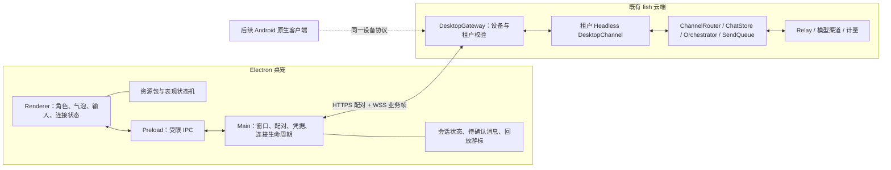
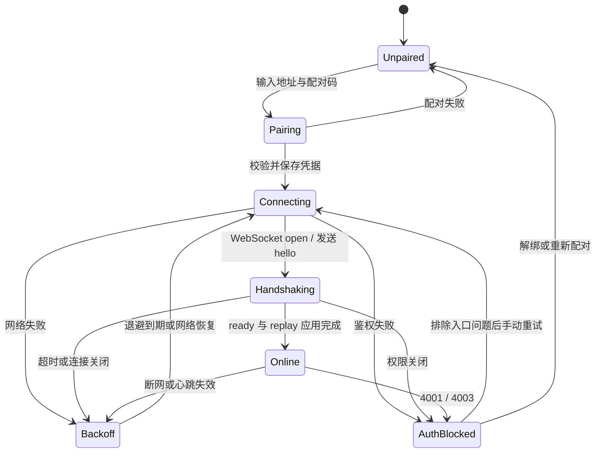

# 养鱼 Bot 桌宠客户端架构设计

> 日期：2026-11-03；状态：待实现的架构方案。本文是本轮唯一交付，不代表已完成客户端改造或实机验收。
>
> 决策依据：treez 本轮要求优先；现有实现以工作区代码及 [multi-entry-implementation.md](multi-entry-implementation.md)、[goal-progress.md](goal-progress.md)、[desktop-protocol.md](desktop-protocol.md) 为准。`E:/bigPeach/huangtao-files/fish-agent-design.md` §4.3 是设计来源，其中尚未落地的字段不能当作当前协议使用。

## 1. 结论与范围

在现有 `packages/desktop-pet` 上继续开发。直接选取 dsh-pet 的 MIT 窗口、交互和播放调度代码，适配到 fish 已有的 Electron 主进程、配对和连接骨架中。保留现有 cloud-manager → 租户 Headless → Agent → Relay 链路，桌宠只是用户入口。

首个交付目标为 **Windows 桌面 MVP**：透明置顶窗口、自有占位形象、可拖动、对话气泡和文本输入、配对码连接租户、收发消息、断线重连及明确的连接状态。先沿用当前 JavaScript/ESM 和轻量 DOM/CSS，不为这个规模引入新的 UI 框架、Python 服务或第二套 Agent。正式形象以后替换资源包即可。

本轮设计约束：

- dsh-pet 的形象、动画、图片、图标、音效、提示词、源视频等一律不带入，也不临时用作占位。占位形象使用独立创作的中性几何角色，不临摹原角色。
- LLM、人设、记忆、工具权限、租户隔离、计量仍由 fish 云端负责；客户端不持有模型 API Key、Relay Key 或面板 Cookie。
- 语音、Live2D/VRM、养成、插件、换装、多宠、自动更新、截图和电脑控制不进入 MVP。
- 安卓本轮只定边界与选型，不新增 Android 工程，不为了跨端复用改动云端协议。
- 下文的“现有”表示已读到的实现；“拟新增/改造”是后续开发任务。本轮不执行迁移、复制代码、安装依赖或修改其他文档。

### 1.1 已有基础及参考快照

| 项目 | 核对结果 | 对本方案的影响 |
|---|---|---|
| fish 工作区 | HEAD 为 `32b83f0ba58dc5101dbf59477d96bebcb715b97c`，多入口和桌宠等实现包含未提交改动，另有并行 review | HEAD 不是完整实现快照；以后开工前重新核对相关文件，保留其他会话改动 |
| 现有 Electron 客户端 | `src/main.js` 已有透明无边框置顶窗口、托盘、safeStorage、IPC；`src/client.js` 已有配对、WS、重连、消息队列；另有渲染、安全图片处理及测试 | 复用连接与安全边界，把现有固定界面改成资源包驱动的桌宠 |
| 现有云端 | `src/desktop/device-service.js`、`gateway.js` 和 Headless `desktop-channel.js` 已串联设备身份与会话 | MVP 不另建服务或暴露 OneBot action |
| dsh-pet | 本地 `E:/bigPeach/ref/dsh-pet`；commit `3229ab287d82d7621af2ee51544a0e746c2e40fd` | 选取 MIT 代码；逐文件记录来源与改造 |
| AIRI | 本地 `E:/bigPeach/ref/airi`；commit `ee18bd176d5306dc3ef2dad1de40964250b2832b` | 参考能力抽象及主进程/渲染进程边界 |
| Open-LLM-VTuber | 本地 `E:/bigPeach/ref/Open-LLM-VTuber`；commit `992309c0aa19845960228f880013d4685fde93b5` | 参考能力接口、后端表情信息和 WS 消息分类 |

现有进度文档记录过本地模拟联调通过，但明确未完成 Windows 安装包、系统安全存储真实配对及 macOS 实机验收。本文不将那些测试记录扩大为桌宠成品验收结果。

## 2. 总体架构与职责



客户端与云端使用 WebSocket；Electron 内部使用 IPC。这两个边界各自管理生命周期，不在 renderer 中启动 WebSocket，也不把 dsh-pet 的宿主桥接服务一起搬入。

| 模块 | 职责 | 边界与后续改造 |
|---|---|---|
| WindowController（主进程） | 透明、置顶、拖动、工作区边界、托盘显示/退出、焦点与穿透 | 原生屏幕坐标只存在此层；renderer 上报经校验的局部交互矩形 |
| PairingService / CredentialStore（主进程） | 校验服务地址、兑换配对码、校验返回地址、加密保存凭据 | 令牌不返回 renderer，不写日志；保存失败不假装配对完成 |
| Transport（主进程） | 原生 `ws`、Bearer 请求头、握手、关闭、背压 | 提供结构化事件，不携 UI/动画逻辑；不允许任意 URL 或任意请求头透传 |
| SessionController（主进程内的领域逻辑） | hello/ready、心跳、退避、消息 ID、ack、seq、回放、待发送队列 | 拆出纯状态转换；时间、随机数、ID、存储和网络以接口注入 |
| SessionStore（主进程） | 凭据绑定的会话快照、待确认消息、最近消息、游标 | 按服务地址及设备身份隔离；更换设备不能沿用旧租户队列 |
| Preload | 明确列出的命令及订阅事件 | 沿用 `contextBridge`；不暴露 `ipcRenderer`、文件系统或通用 invoke |
| ChatView / ConnectionView（renderer） | 文本气泡、输入、发送状态、错误、配对表单、“AI 生成”提示 | 文本按文本节点渲染；不解释模型输出中的 HTML、脚本或动作指令 |
| PresentationController / PetView（renderer） | 把云端状态与本地交互映射为资源动作 | 不读 token，不改业务消息，不自行生成情绪结论 |
| ResourcePackLoader | 校验 manifest、解析安全资源、缺失回退 | 主进程校验路径和包；renderer 只得到允许展示的资源描述 |
| 既有云端 | 身份、对话、记忆、权限、模型调用、限额和计量 | 客户端展示状态，不自行结算费用或把 online 秒数当账单 |

### 2.1 窗口与交互方案

MVP 保持一个透明 `BrowserWindow`，在同一渲染树内放角色和可展开的聊天面板。配对时展开表单；配对后点击角色展开/收起输入与最近对话，回复显示气泡。主进程负责窗口尺寸及屏幕内定位，避免气泡超出窗口被裁切；折叠时恢复紧凑尺寸。需要分离气泡窗口时再引入第二个窗口。

从 dsh-pet 借用交互区域和拖动思路：角色、输入框、气泡按钮属于可交互区域，透明空白可以穿透；输入或拖动期间强制保持可交互，不能让 `setIgnoreMouseEvents` 吞掉键盘操作。保留明确的拖动区域及托盘“显示桌宠”作为找回入口，拖动结束夹紧到 `screen.workArea`。MVP 不做投掷、爬行或全屏跟随。

连接状态与角色状态分开显示。例如断线时仍可显示 idle 占位形象，但旁边必须写“连接断开，正在重试”。没有语音的阶段，“收到回复”的短暂动作不代表正在播放音频。窗口和内容附近持续可见“AI 生成”，不依赖服务端某一帧是否带标识。

## 3. 拟定目录结构与迁移方式

以下为后续目标结构，不是本轮创建清单。MVP 先在 `desktop-pet` 内模块化，安卓开工且出现第二个消费者时再提取共享包；避免现在引入一套空的跨端工程。

```text
packages/
  desktop-pet/
    package.json                   # 沿用启动/测试/打包入口
    package-lock.json
    scripts/dev.mjs                # 沿用显式开发依赖回退
    src/
      main.js                      # 保留为组合入口
      preload.cjs                  # 受限桥接，补订阅取消与参数约束
      main/                        # 拟新增；从 main.js 分离
        window-controller.js
        pairing-service.js
        credential-store.js
        session-store.js
        ws-transport.js
        ipc-handlers.js
        resource-pack-loader.js
      core/                        # 拟新增；不依赖 Electron/Node API
        protocol-v1.js             # 帧校验与领域事件
        session-machine.js         # 连接、重试、消息转换
        presentation-machine.js    # activity / emotion / 本地交互
        resource-manifest.js
        ports.js                   # 平台接口契约，可先使用 JSDoc
      index.html
      renderer.js                  # 组合 ChatView、PetView 等
      style.css
      ui/                          # 拟新增；轻量 DOM 模块
        chat-view.js
        pet-view.js
        connection-view.js
      vendor/dsh-pet/               # 仅选取的 MIT 代码及改造记录
        pointer-target.cjs
        desktop-geometry.cjs
      image.js                     # 保留现有安全消息图片处理
      pair-response.js             # 保留现有有界响应读取
      tray.png                     # 后续核验来源或替换为自有图标
    resources/pets/placeholder/
      manifest.json                # 自有静态占位包，后续创建
      idle.png
      LICENSE.txt
    licenses/dsh-pet-MIT.txt        # 实际复制代码时带入许可全文
    THIRD_PARTY_NOTICES.md          # 来源、commit、文件、改造及许可
    test/
      client.test.mjs               # 保留现有回归
      fixtures/protocol-v1/         # 后续跨语言共用 JSON 测试向量
      resource-pack.test.mjs
      presentation.test.mjs
  pet-contracts/                   # 后续按需提取：schema、测试向量、规范
  android-pet/                     # 后续 Android 工程，当前不创建
```

现有 `client.js` 的 `endpoint`、`pairDevice` 和 `PetConnection` 逐步分别迁入地址/配对、传输和状态模块，迁移期间保留导出兼容层与原测试。它当前依赖 `node:events`、`node:crypto` 和 `ws`，不能直接称为跨平台共享内核。纯逻辑抽离后可以复用于 JS 宿主，Kotlin 端则按同一契约实现并运行同一组测试向量。

`vendor` 保留适合独立维护的小模块；与上游 `PetSprite`、全局常量高度耦合的部分，应复制必要代码并适配到 `PetView`，同时保留出处，不能把一组缺依赖的原文件直接放进去。上游是 CommonJS 的文件保留 `.cjs`，或在明确记录改造后转换为 ESM。

新增 `resources`、`licenses` 后，后续开发必须同步更新 electron-builder 的明确打包清单。当前清单只有 `src/**/*` 和 `package.json`，不能假定它会自动带入新资源目录；打包应用也不得依赖 `qq-agent-core/node_modules` 的开发回退。

## 4. 从 dsh-pet 借用的具体代码

本节路径均相对 `E:/bigPeach/ref/dsh-pet/dsh-pet/runtime/electron-helper/`，对应前述固定 commit。选取代码进入 fish 包维护，不运行 dsh-pet/DSH 宿主，也不把参考仓库作为运行依赖。

| 来源文件/模块 | 借用内容 | fish 落点与改造 | 阶段 |
|---|---|---|---|
| `main/windows.js` / `createWindows` | 透明无边框窗口、交互区域与鼠标穿透协调 | 将必要代码并入 `window-controller.js`；保留 fish 单窗口、托盘、安全选项，删除多宠、原图标及宿主依赖 | MVP |
| `pointer-target.js` / `spriteHitRect`、`pointerZone`、`decideWindowIgnore` | 命中矩形、区域分类与穿透决策 | 选取纯计算部分；原角色尺寸/脚点/命中常量改为资源包及布局输入，气泡/输入区域优先 | MVP |
| `desktop-geometry.js` / `buildDeskGeometry` | 屏幕 bounds/workArea、整体边界与主屏信息汇总 | 解除对原 `HIT_BOX/STAGE_W/CANVAS_H/FEET_Y` 的耦合；fish 按通用锚点另加角色位置夹紧与归位 | MVP |
| `main/displays.js` / `createDisplaySync` | 显示器变化处理 | 单窗口版本；拔屏后找回角色、重算工作区、恢复安全位置 | MVP |
| `sprite/input.js` / pointer handlers、`syncInputRegions` | 点击/拖动区分、交互区域同步 | 适配本项目 IPC；点击打开输入，拖动不误发消息；不复制原声效和角色动作名 | MVP |
| `sprite/motion.js` / `startDragFollow` 等 | 拖动跟随与回到可见区域 | MVP 只抽取拖动/归位相关必要逻辑，投掷与自由运动后置 | MVP / 后续 |
| `sprite/playback.js` / `switchTo`、`playOnce`、`playIdle`、`handleEnded` | 动作切换、加载失败时释放待切换状态并报告、一次性动作完成后的恢复 | 抽取状态调度进入 PetView；fish 新增 manifest fallback。MVP 静态图只需最小调度，双视频换帧待支持视频包时再移植；删除任意远程 URL 入口 | MVP 最小子集 / 后续 |
| `dpi-linearization.js`、`main/dpi.js` | DPI/缩放问题的参考处理 | 先使用 Electron 的屏幕坐标体系；混合 DPI 实机复现问题后有选择地移植，不能原样强制全局比例 | 后续或缺陷修复 |
| `main/tray.js`、`topmost-watchdog.js` | 托盘、置顶恢复经验 | fish 已有托盘和 alwaysOnTop；MVP 复用现有实现，不增加重复 watchdog | 参考 |

需要删除或重写的硬编码包括：`sprite.js` 中 `click-duck.wav`，`renderer.js` 的原 cursor PNG，`main/tray.js`、`main/windows.js` 的 logo，以及原 `electron-builder.yml` 的素材清单。`main/windows.js` 的 `sandbox:false`、`main.js` 自定义协议的 `bypassCSP:true`、原 HTML 中宽松远程源、`main/ipc.js` 的宽泛外链/截图能力都不继承。

**排除清单**：参考仓库中的 `dsh-pet/assets/webm`、`pic`、`preview`、`memes`、`sound`、`fonts`、`logo.png`、原 `assets/config.jsonc`，以及根目录的截图、视频、提示词和其他角色资源。这里字体/声音也不因未逐项核验就默认可用。只从代码白名单取文件，禁用“整目录复制后再删素材”的导入流程。

## 5. AIRI 与 Open-LLM-VTuber 的架构借鉴

| 参考及精确路径 | 借鉴点 | fish 的落实方式 |
|---|---|---|
| AIRI `packages/stage-ui/src/stores/providers/provider.ts` | provider definition/config 与能力创建分离，可查询 transcription 等能力 | 云端统一 LLM/TTS/ASR 能力接口；具体供应商留在云端配置，不搬客户端密钥管理 |
| AIRI `packages/stage-ui/src/stores/modules/airi-card.ts` | 把模型可用表情/动作与对话输出关联 | 使用有限语义状态，由资源包做映射；不把模型专属 ACT 指令开放成任意客户端动作 |
| AIRI `apps/stage-tamagotchi/src/preload/shared.ts`、`src/shared/model-settings-runtime.ts`（后者同属该 app） | 受限桥接与明确的跨进程事件定义 | 保持 fish preload 白名单、事件类型和平台边界 |
| Open-LLM-VTuber `src/open_llm_vtuber/agent/stateless_llm/stateless_llm_interface.py`、`asr/asr_interface.py`、`tts/tts_interface.py`、`service_context.py` | 分开的可替换能力接口和组合根 | fish 继续使用既有 LLM/Relay 路由，未来以 adapter 接入语音，不复制 Python 服务 |
| 同项目 `live2d_model.py`、`conversations/tts_manager.py`、`utils/stream_audio.py`（均在 `src/open_llm_vtuber/`） | 后端抽取表达信息并与输出一起送达 | 参考“后端提供语义、前端选表现”；不复制原关键词表、模型表达索引或音频协议 |
| 同项目 `src/open_llm_vtuber/websocket_handler.py` | 会话/控制/音频消息分型 | 未来按能力分型扩展 fish 协议，仍通过 DesktopGateway 鉴权，不另开免鉴权通道 |

这些接口不能直接当作 fish 的流式协议：参考 TTS 主要返回文件路径，ASR 有整段音频接口。fish 面向云端、多租户和移动端，需要另定分片、背压、取消及错误语义。

后续云端能力边界建议为 `LLMProvider`（复用现有路由）、`ASRProvider`（音频到文本）、`TTSProvider`（文本到音频），通过租户配置选择实现。统一超时、取消、能力查询和计量上下文；密钥不出云端。客户端只负责采集/播放，并可通过平台适配器选择系统 TTS；那是独立的后续能力，不在 MVP 创建空的 provider 注册系统。

## 6. 与现有 Desktop Gateway 的对接

权威实现：[device-service.js](../packages/cloud-manager/src/desktop/device-service.js)、[gateway.js](../packages/cloud-manager/src/desktop/gateway.js)、[desktop-channel.js](../packages/qq-agent-core/modules/headless/desktop-channel.js)、[client.js](../packages/desktop-pet/src/client.js)。以下均为现有 v1，另有明确标注的客户端改造建议。

### 6.1 配对、身份与地址

1. 用户在云面板启用桌宠入口、准备模型渠道和实例；有权限的 owner/operator/admin 生成配对码。面板使用 `POST /api/tenants/:id/desktop/pairing-codes`，不是桌宠持设备令牌去调用该 API。
2. 客户端填写服务 origin 与 8 位配对码，主进程调用 `POST /desktop/v1/pair`。请求 `{code, deviceName, os}`；设备名非空且最多 80 字符，`os` 最多 40 字符，Windows 使用 `win32`，未来 Android 可使用 `android`。
3. 成功返回 `{ok:true, deviceId, deviceToken, desktopUserId, tenantSlug, wsUrl}`。配对码一次性、10 分钟有效；设备令牌形如 `fdt_...`，云端保存 SHA-256。每用户最多三台有效设备，另受租户有限席位上限约束。
4. 主进程完成字段/大小校验和凭据加密落盘后再连接。现有配对读取上限 64 KiB；保留拒绝重定向。`wsUrl` 必须为与配对地址同主机、对应端口的 `/desktop/v1/ws`，不接受 query、账号密码或 fragment；HTTPS 配对只接受 WSS。开发明文仅 loopback。
5. WS Upgrade 使用 `Authorization: Bearer <deviceToken>`，不传 Cookie、URL token 或 Origin。网关拒绝浏览器 Origin，因此 Electron renderer、普通 WebView 的浏览器 WebSocket 不能代替主进程/原生 Transport。
6. 网关鉴权后，仅代理到该租户 loopback `/channels/desktop/ws`，自行注入 console token、设备 ID 和桌宠用户 ID。客户端不传这些内部头、不选目标用户、不接触 Agent 内网端口。

`desktopUserId` 由云端分配；当前范围为 `[7459086882832384,7599824371187711]`。同租户同面板用户的设备共享 `private:<desktopUserId>`，安卓沿用这一身份即可。客户端内部按不透明字符串处理 ID，不依赖号段算术；配对响应目前可能是 JSON 数字，解码时明确规范化为字符串。草案中的更大号段及 `perDeviceSession` 开关不是当前能力。

更换设备表示停止连接并清除本机凭据/会话，不等于云端吊销；需要在面板删除设备才能释放有效席位并使旧令牌失效。MVP 手输配对码即可，不要求客户端注册 `fishpet://` 或扫描二维码。

### 6.2 帧与消息段

通用信封为 `{v:1, op, id?, seq?, ts?, d}`，`ts` 为毫秒时间戳；只传文本 JSON，不传二进制音频。现有 WS 单帧上限 3 MiB。

| op | 方向 | 当前有效字段与处理 |
|---|---|---|
| `hello` | C → S | `d.deviceId`、`d.resumeSeq`；连接后 10 秒内发出。客户端还发 `clientVersion`、`caps:['text']`，服务端目前未协商 caps |
| `ready` | S → C | `d.selfName`、`d.aiLabel`、`d.replay`、`d.serverSeq`；应用 replay 后进入可发送状态 |
| `msg.send` | C → S | 顶层唯一 `id`，`d.segments`；重试复用原 ID。ID 合法字符为字母数字、下划线、点、连字符，最长 128 |
| `msg.ack` | S → C | `d.id` 为原客户端 ID，`d.messageId` 为服务端消息 ID；表示入口处理已接受，不代表模型回复已完成 |
| `msg.push` | S → C | 顶层 `seq`，`d.messageId`、`d.segments`、`d.aiLabel`；Bot 回复，按 seq 去重 |
| `msg.echo` | S → 同用户其他设备 | `d.messageId`、`d.segments`；在线同步用户发送的消息，无 seq，不进入当前 replay |
| `state` | S → C | `d.mood`；客户端允许 `idle/thinking/talking/sleeping`。当前 `app.js` 的 session-start/end 实际驱动 thinking/idle |
| `pet.poke` | C → S | `d:{}`，复用既有戳一戳；可保留，但不作为 MVP 核心入口或必需功能 |
| `ping` / `pong` | 双向 | `d:{}`；30 秒应用心跳，约 90 秒未收到活动则断开 |
| `error` | S → C | `d.code`、`d.message`；当前无统一关联请求 ID，也不保证有 retryAfter |

最小交换示例（设备信息与 ID 为示意值，非可用凭据）：

```json
{"v":1,"op":"hello","d":{"deviceId":"ddev_example","resumeSeq":12,"clientVersion":"0.1.0","caps":["text"]}}
{"v":1,"op":"ready","d":{"selfName":"养鱼 Bot","aiLabel":"AI 生成","replay":[],"serverSeq":12}}
{"v":1,"op":"msg.send","id":"c-94c2573a","d":{"segments":[{"type":"text","data":{"text":"你好"}}]}}
{"v":1,"op":"msg.ack","d":{"id":"c-94c2573a","messageId":"m-in-1"}}
{"v":1,"op":"state","d":{"mood":"thinking"}}
{"v":1,"op":"msg.push","seq":13,"d":{"messageId":"m-out-1","segments":[{"type":"text","data":{"text":"你好呀"}}],"aiLabel":true}}
{"v":1,"op":"state","d":{"mood":"idle"}}
```

示例只展示字段，不承诺 ack、state 和回复之间的固定到达顺序。客户端收到 ack 后显示“已受理/等待回复”，收到 push 才展示回复；允许回复先于 ack 到达。

当前服务端支持 `text`、`face`、`reply`、`image`，每条最多 32 段，单 text 最长 10000 个 JavaScript 字符单元；图片仅校验后的 PNG/JPEG/GIF/WebP 内嵌 base64、解码后不超过 2 MiB，拒绝文件路径和远程 URL。`reply` 只能引用该用户的消息。MVP 输入只暴露文本，接收保留现有安全降级显示；不把 `face` 消息段误解为角色表情指令。

当前没有 `msg.recall`、任意文件发送、LLM 文本增量、语音流、emotion、avatar、persona 快照或能力协商结果。不能直接使用原始设计稿中的这些设想，也不能发送尚未实现的新 op。

### 6.3 重连、回放和发送状态

拟将现有 `PetConnection` 行为拆为显式状态机，并补齐故障展示：



`AuthBlocked` 是拟新增的客户端分类，现有实现把鉴权失败统称 revoked。用户退出/解绑必须从任意状态取消 socket、定时器和旧连接回调；一台客户端同一时刻只允许一个有效连接代次。

- **发送状态**：每次提交先生成稳定 ID，保存本地 pending，再发送；ack 后移出 pending。本地 UI 区分“待发送”“等待确认”“已受理”和“结果未确认”。MVP 建议每设备同一时间只发送一条尚未 ack 的请求，其余排队，便于处理当前没有请求 ID 的 error。
- **重试**：沿用约 1、2、4、8、16、30 秒基值与 ±20% 抖动；现有代码先截断基值再抖动，实际最大约 36 秒。正常 ready 后重置次数，网络恢复/唤醒可提前重试，但先终止旧连接。拟补客户端 ready 超时，避免 WS open 后长期停在半连接状态。
- **有界存储**：现有客户端 pending 最多 100 条，队列预算约 8 MiB；最近消息最多 200 条且约 8 MiB。预算当前按 JSON 字符串长度计算，后续跨端统一为 UTF-8 字节预算并补限制测试。满额时明确拒绝新提交，不静默覆盖待发送消息。拟区分草稿与发送中的消息，避免每次按键落盘。
- **回放**：服务端按用户保留最近 200 条且不超过 24 小时的 `msg.push`；`hello.resumeSeq` 带本地已应用游标，`ready.replay` 中的新 push 依次处理。只在消息与游标一起成功保存后推进恢复点，不直接用 `ready.serverSeq` 覆盖游标跳过消息。
- **去重边界**：服务端以 `deviceId:msg.id` 去重，保留最近 1000 个键；客户端按 `seq` 去重回复，按 messageId 去重 echo。服务端落盘是尽力而为，不能承诺进程崩溃后完整恢复，也不能承诺长期离线下恰好一次处理。
- **长离线与缺口**：`msg.echo` 没有离线回放，旧 push 也可能已过保留窗口。拟根据 replay 首序号、连续性及 serverSeq 检出缺口并提示“部分历史无法恢复”，保留现有内容。若服务端序号回退，暂停自动补发并提示会话恢复异常，不能盲目清零或无限忽略新消息；后续再通过 epoch/恢复协议解决。
- **不确定发送**：只对当前进程内短暂断线、正常序号连续的未确认请求自动用原 ID 重试。长离线、进程重启后或去重状态不明时，拟将已尝试发送但未 ack 的消息标为“结果未确认”，让用户选择重试或丢弃；提示可能重复。客户端无法仅凭离线时长证明服务端仍持有去重键。真正从未发出的本地排队消息可在恢复后发送。

现有客户端还没有完整的 ready 超时、缺口检测、发送失败状态和上述保守恢复分支；这些是 MVP 客户端完善项，不声称已由当前协议解决。`INVALID_SEGMENTS/INVALID_MESSAGE` 对应唯一在途消息时应标为失败并停止自动发送；`IN_PROGRESS` 保留等待确认，`INGEST_FAILED` 标为未接受并允许用户重试。没有可明确关联的错误只展示连接级提示，不删除队列中的任意消息。

### 6.4 错误分类与权限失效

| 情况 | 客户端处理目标 | 当前实现限制 |
|---|---|---|
| 配对 `PAIRING_EXPIRED` / `INVALID_PAIRING` | 留在配对页，提示重新生成/检查配对码 | 现有 pairDevice 对非 2xx 只显示 HTTP 状态，拟读取有界结构化错误 |
| `SEAT_LIMIT` | 指向面板设备管理；不自动循环兑换同一码 | 不从客户端判断或收费 |
| HTTP 401 / 明确 `TOKEN_REVOKED` / 4001 | 停止重连，提示重新配对或检查设备权限 | 4001 也可能来自连接期间权限复核失败，不能仅凭它断言用户主动吊销 |
| HTTP 403 / 4003 | 停止自动重试，保留凭据；提示检查入口、租户/用户权限，允许处理后手动重连 | 当前统一显示 revoked；应区分禁用、Origin 错误与令牌失效 |
| HTTP 429 | 有界退避，尊重实际返回的重试提示 | 不假定已有 retryAfter；不重新申请令牌 |
| HTTP 503 `AGENT_NOT_RUNNING`、网络错误、1006/1011/1013 | 显示暂不可用并退避，保留队列 | 网关目前将上游 close 归一为 1011，不能依赖上游私有码透传 |
| 协议版本/帧校验持续失败 | 显示不兼容，暂停循环失败并提供手动重连 | 服务端错误不都能按原始 close code 到达客户端 |

鉴权、席位与计量仍由云端决定。此设计不改变现有按 entry 归因的 token 结算，也不把非 token 计量改成收费项目。

## 7. 资源包与后端状态驱动

### 7.1 MVP 资源包格式

先支持内置、版本化、只含数据和图片的目录包。MVP 使用我方制作的一张静态 PNG，四种 activity 可以映射到同一图，由 UI 文字/轻微通用动效区分；实现时用第二个自有几何占位包验证替换，正式美术不构成开发依赖。以下 manifest 是**拟定格式示例**，对应文件本轮不创建：

```json
{
  "schemaVersion": 1,
  "id": "fish.placeholder",
  "version": "0.1.0",
  "name": "几何占位角色",
  "author": "养鱼 Bot 团队",
  "license": { "id": "LicenseRef-Fish-Owned", "file": "LICENSE.txt" },
  "canvas": { "width": 256, "height": 256 },
  "anchor": { "x": 0.5, "y": 1.0 },
  "hitBox": { "x": 0.15, "y": 0.1, "width": 0.7, "height": 0.85 },
  "assets": { "base": { "type": "image", "path": "idle.png" } },
  "actions": { "idle": { "asset": "base", "loop": true } },
  "activityMap": { "idle": "idle", "thinking": "idle", "talking": "idle", "sleeping": "idle" },
  "emotionMap": { "neutral": "idle" },
  "fallbackAction": "idle"
}
```

`canvas` 定义包的逻辑尺寸；`anchor/hitBox` 是归一化坐标，不保存桌面绝对位置。平台层将其转换为 Electron DIP 或 Android dp/像素。形象、动作与聊天内容分离，包里没有设备令牌、模型提示词、API 地址或租户逻辑。

MVP 只接受 schemaVersion 1、PNG/静态 WebP，默认预算建议为 manifest ≤64 KiB、包 ≤20 MiB、≤64 个资源文件、单图边长 ≤2048；大小、解码尺寸、文件类型和路径均校验。资源路径限包根下相对文件，拒绝 `..`、绝对路径、盘符、UNC、URL、符号链接越界及脚本；不执行包内 JS/HTML，不加载远程字体和资源。不支持用户下载 ZIP 安装，后续增加安装器时再处理解压穿越、签名/哈希及原子切换。

缺失动作回退到 `fallbackAction`，包无效则回到内置占位；未知 schema 主版本拒绝加载。切换包要释放旧图像/动画句柄，不重建网络连接、不丢会话。后续可为 `actions` 增加帧序列和平台支持的媒体变体，透明 WebM、Lottie、Live2D/VRM 只能在对应适配器及授权就绪后启用，不作为跨端共同格式的前提。

### 7.2 状态与情绪分层

现有 `state.d.mood` 虽名为 mood，实际更接近**会话活动状态**。MVP 内部规范化为 `activity`：thinking → 思考提示，idle → 空闲；talking/sleeping 为兼容值。当前真正的云端事件来源是 [app.js](../packages/qq-agent-core/src/app.js) 对 `session-start/session-end` 的 thinking/idle 广播；客户端不能宣称已有细粒度情绪推理。

表现控制器分别持有 `connectionStatus`、`activity`、`emotion` 和本地拖动/焦点状态。连接状态在 UI 中独立显示；活动状态优先选择动作，其次再叠加包支持的情绪表现，缺失映射回 neutral/idle。拖动等本地交互只临时影响姿态，不改写云端状态。断线或恢复超时重置过期的“思考中”表现，同时保留明确的未知/离线提示。

后续“后端情绪驱动表情”采用有限语义值，例如 `neutral/happy/sad/curious`，由云端对模型输出做白名单归一化，携带会话轮次/有效期；客户端映射为资源包动作，不接收模型文件路径、任意表达式或 Live2D 数字索引。未知 emotion 降为 neutral，过期轮次不得覆盖新回复。具体字段与协商方式见下一节，当前 v1 不发送这些扩展。

## 8. 为语音、安卓和后续协议保留的边界

### 8.1 现在预留的接口

| 接口 | Electron 实现 | Android 后续实现 |
|---|---|---|
| `Transport.open/send/close` 与 opened/frame/closed/error 事件 | 主进程 Node `ws`，带 Bearer、无 Origin | 原生 WebSocket，例如 OkHttp；保留同样的鉴权与地址约束 |
| `CredentialStore.load/save/clear` | safeStorage + 本地加密文件 | Android Keystore 管理密钥，加密保存应用私有目录中的凭据 |
| `SessionStore.load/commit/clear` | 原子保存有界快照 | Room/私有文件等事务存储，和凭据绑定 |
| `Clock/Scheduler/IdGenerator` | 注入时间、定时器、随机数/UUID | Kotlin 实现；测试向量可控制时钟，支持进程重建 |
| `Lifecycle/Connectivity` | Electron powerMonitor、网络事件、退出 | Activity/Service 生命周期与 ConnectivityManager |
| `PetView/ResourceResolver` | DOM/Canvas 与受限本地资源加载 | 原生 View/绘制器、相同 manifest 与静态资源 |
| `WindowSurface/InputController` | BrowserWindow、DIP、焦点、鼠标 | WindowManager、dp、触摸、IME；此层不共享实现 |
| `AudioCapture/AudioPlayback`（后续） | 桌面权限、设备和播放队列 | Android 录音权限、音频焦点和生命周期 |

所有公开状态为可序列化数据，不携 Node EventEmitter、Electron 对象、DOM 节点或平台文件路径。跨端统一毫秒时间戳、字符串 ID、消息段、错误分类、资源 schema 和状态转换测试。不要把“协议相同”写成“安卓可直接执行现有 JS”。

### 8.2 协议扩展顺序（均未实现）

1. 先补协议契约及跨端测试向量，再设计真正的能力协商。目前 hello.caps 只是附带字段。未来客户端/服务端共同启用 capability 后才使用新 op；破坏性改变使用新版本/端点，旧客户端仍能纯文本工作。
2. 优先补带请求关联 ID 的 error、恢复游标 epoch、历史缺口标记、去重结果查询/有效边界，以解决跨进程和移动长离线恢复；不把 `serverSeq` 当完整历史。
3. 情绪与流式文本增加明确的 `turnId/messageId`、增量顺序、完成/错误/取消语义；activity 与 emotion 分离。先定义状态与回复的关联，再接语音。
4. 语音需要编码/采样率、分片序号、字节预算、背压、取消/打断、播放完成、音频与文本/表情时序，以及服务端 TTS/ASR 的租户计量。媒体通道可单独设计，但必须由现有身份派生权限；不要把 base64 音频塞进现有 3 MiB v1 帧就视为完成。
5. 安卓暂沿用 `desktop` entry 与现有设备席位，`os:'android'` 仅作设备元数据，不能影响鉴权。若将来需要独立 mobile entry/套餐归因，另做服务端与数据迁移，不由客户端私自改字段。

## 9. 安卓开发方案

### 9.1 选型建议

建议安卓第一版采用 **Kotlin 原生：Activity 承载配对/设置/聊天，WindowManager 承载紧凑悬浮角色，按系统要求使用前台服务管理用户主动开启的悬浮会话**。先实现前台 Activity 内的 v1 收发，再做悬浮体验；若用户拒绝悬浮权限，仍能在应用内聊天。

| 方案 | 可复用部分 | 需要自行实现及代价 | 结论 |
|---|---|---|---|
| Kotlin 原生 | 协议、JSON schema、测试向量、资源包、状态机规则；云端完全复用 | JS 逻辑按契约重写；窗口、权限、IME、服务、Keystore 原生实现 | 推荐；本产品的关键难点就在系统交互 |
| React Native | 抽离后的纯 JS 状态机、协议模型；部分组件设计经验 | 仍需 Kotlin 悬浮窗/服务/安全存储/原生网络桥，不能依赖 JS 线程常驻 | 已有 RN 团队且将来复杂页面很多时考虑 |
| Flutter | 协议与资源规范、测试向量；跨平台 UI | 状态逻辑改写 Dart，悬浮层和服务仍需原生插件/独立引擎生命周期管理 | 如未来有较大的多端 UI 需求再评估 |
| Capacitor | 现有 DOM/CSS 页面复用较多 | WebView 不等于桌面窗口；原生悬浮服务与可加 Authorization/不带 Origin 的 WS 插件不可少 | 可做设置壳，暂不选为桌宠核心 |

以上为基于当前产品边界的工程判断，不以 UI 代码复用率作为唯一指标。安卓 MVP 不依赖 Electron、Node、safeStorage 或浏览器 WebSocket 直连。

### 9.2 悬浮窗、前台服务与输入

以下平台条款查证于 2026-11-03；开发/发布时按目标 SDK 再核对官方文档及渠道要求。

- **悬浮权限**：通过设置页申请 `SYSTEM_ALERT_WINDOW`，返回后用 `Settings.canDrawOverlays()` 检查。API 26+ 使用 `TYPE_APPLICATION_OVERLAY`；通常位于普通 Activity 之上、关键系统窗口之下，与 IME 的层级和输入能力还受窗口 flag 控制。系统可以调整其可见性/位置，不能承诺覆盖所有界面。[权限定义](https://developer.android.com/reference/android/Manifest.permission#SYSTEM_ALERT_WINDOW)、[窗口类型](https://developer.android.com/reference/android/view/WindowManager.LayoutParams#TYPE_APPLICATION_OVERLAY)、[键盘与窗口层级](https://developer.android.com/develop/ui/views/touch-and-input/keyboard-input/visibility)。
- **服务生命周期**：从用户可见的 Activity 操作启动悬浮会话，提供通知和“停止桌宠”入口。运行于 Android 12+ 且目标 API 31+ 时，后台启动前台服务有限制；运行于 Android 14+ 且目标 API 34+ 时，要声明匹配的服务类型和权限；运行于 Android 15+ 且目标 API 35+ 时，若依赖悬浮窗权限豁免后台启动，必须已经有可见悬浮窗，或满足其他豁免。不能先假定后台服务会启动，再靠它创建可见窗绕过限制。[前台服务版本变化](https://developer.android.com/develop/background-work/services/fgs/changes)。
- **服务类型需立项核验**：常驻桌宠没有可以随意套用的“无限保活”类型。不要把 WS 聊天硬标成 dataSync、mediaPlayback、microphone 或 remoteMessaging；`specialUse` 也需具体用途说明，并可能涉及 Google Play 审核。运行于 Android 15+ 且目标 API 35+ 时，dataSync 后台运行受每 24 小时累计 6 小时等限制，不适合被当作永久在线通道。[服务类型](https://developer.android.com/develop/background-work/services/fgs/service-types)、[服务超时](https://developer.android.com/develop/background-work/services/fgs/timeout)。若找不到符合实际用途与分发要求的服务方案，先发布 Activity 内聊天能力。
- **通知与用户停止**：Android 13+ 通知权限拒绝不免除前台服务通知要求，也不必然禁止服务启动；任务管理器仍可展示并停止应用。任务管理器 Stop 会终止应用及悬浮层，不保证给应用清理回调；下次启动应尊重用户停止。应用内主动关闭或权限撤销时也应收起悬浮层，不偷偷重启。[通知权限](https://developer.android.com/develop/ui/compose/notifications/notification-permission)、[处理用户停止](https://developer.android.com/develop/background-work/services/fgs/handle-user-stopping)。
- **触摸与键盘**：默认小窗口只占角色区域，避免整屏透明窗挡住其他应用。安卓首版点角色打开 Activity 输入，降低焦点冲突；若以后做悬浮输入，显式切换可聚焦状态、处理 IME 与返回键，结束后恢复。不能照抄桌面鼠标穿透，Android 12+ 有不可信 overlay 触摸限制。[不可信触摸](https://developer.android.com/about/versions/12/behavior-changes-all#untrusted-touch-events)、[键盘可见性](https://developer.android.com/develop/ui/views/touch-and-input/keyboard-input/visibility)。

### 9.3 网络、续传与安卓验收

前台服务不保证永久持有 WebSocket。Doze、网络切换、进程死亡及厂商限制都可能中断连接；WorkManager 不能替代实时长连接。安卓持久化凭据、pending 和恢复游标，在用户回到应用或允许的生命周期恢复点重新鉴权、hello 与回放。离线状态、有限回放、可能重复和用户主动停止均沿用前述规则；不依赖无限后台心跳。[Doze 与 App Standby](https://developer.android.com/training/monitoring-device-state/doze-standby)。

如以后需要离线消息提醒，另评估 FCM/厂商推送与云端离线事件；推送只是恢复/提醒信号，不能替代带身份校验的消息获取，也不承诺不同地区/设备生态都可用。

后续安卓验收覆盖 Android 12–16 中与目标 SDK 相关的行为和目标厂商 ROM：权限拒绝/撤销、通知关闭、输入/键盘、旋转/分屏、悬浮边缘避让、Wi-Fi/蜂窝切换、Doze、进程死亡、任务管理器 Stop、重启与服务超时。检查恢复后不重复显示回复、不无限补发不确定消息、不循环重试已失效令牌，并记录空闲耗电。现在只保留接口和测试规范，不以桌面测试替代这些实机验证。


## 10. Electron 安全与许可证边界

### 10.1 客户端安全要求

保留现有 `contextIsolation:true`、`nodeIntegration:false`、`sandbox:true`、拒绝导航/新窗口和严格 CSP。renderer 不联网，新增图片/媒体只按明确资源源放行；聊天文本不使用 innerHTML。IPC 除参数校验外拟补 sender/frame 来源校验，窗口操作不能接收任意进程/路径/URL。此取舍与 [Electron 安全指南](https://www.electronjs.org/docs/latest/tutorial/security/) 一致。

凭据只在主进程内通过 CredentialStore 使用系统加密保存，日志遮蔽 token、配对码和默认聊天正文。安全存储不可用时明确失败，不退回明文。safeStorage 的平台保护能力不同，Windows 不能据此声称防御同用户恶意进程；后续支持 Linux 时还要拒绝不安全的 `basic_text` 后端。依赖升级时按实际 Electron 版本选择可用 API，不能照着最新版文档直接调用当前锁定版本不存在的方法。[safeStorage 官方说明](https://www.electronjs.org/docs/latest/api/safe-storage)。

发布前选择仍受支持的 Electron 版本并完成兼容回归；本轮不改锁文件，也不把现有 `^33.2.0` 声明当作长期版本决策。桌宠不请求管理员权限，不增加截图、全局键盘记录、任意 shell/文件访问能力。

### 10.2 许可与素材处理

- dsh-pet 根 `LICENSE` 及 `dsh-pet/LICENSE` 是 MIT，版权为 `Copyright (c) 2026 PC2005-cloud`。实际复制代码时保留版权和许可全文，改造文件记录来源路径、commit 和变更；打包成品带 `THIRD_PARTY_NOTICES` 和相应许可。
- 上游 README 的许可段另外声明动画/提示词/源视频禁止商用，形象为 CC BY-NC-SA 4.0，并提出衍生/改版/换皮作品在 GitHub、官网等公开渠道附作者链接的约定。未来公开项目说明中保留 [PC2005-cloud/dsh-pet 来源链接](https://github.com/PC2005-cloud/dsh-pet)，明确“使用其部分 MIT 代码，角色及素材另行创作”。该 README 约定和 MIT 文本分别记录，不把整仓素材解释为 MIT。
- CC BY-NC-SA 包含非商业与相同方式共享条件，署名不等于获得商业授权；本项目直接执行 treez 的更严格排除决定，不使用、改色、裁切或转换格式来规避素材限制。[CC BY-NC-SA 4.0 官方条款说明](https://creativecommons.org/licenses/by-nc-sa/4.0/)。
- AIRI 根 LICENSE 为 MIT；Open-LLM-VTuber 根 LICENSE 为 MIT，但明确 Live2D 示例模型另受 `LICENSE-Live2D.md` 管理。本方案仅借鉴其架构；若以后实际复制代码，同样随附对应许可。模型、字体、声音、SDK 和第三方包各自核验，不从代码许可推导素材许可。
- 占位和正式资源包保存作者、来源、许可及团队可用范围；商用前确认我方拥有相应权利。“后面自己画”要求独立设计，不是重绘上游受限制形象。当前 fish 中已有的“大肥鱼”文案、CSS 角色和托盘图标，需要后续逐项核验或替换；本次只读审查不作其权属结论。

后续导入时按代码白名单检查新增文件和安装包内容，尤其确认没有原 webm、logo、cursor、音效、提示词、截图及预览图混入。资源校验器只能检查结构/路径，不能代替人工核对版权来源。

## 11. MVP 范围与验收标准

验收对象是后续实现后的 Windows 客户端。沿用 [desktop-client.md](desktop-client.md) 的开发入口：仓库已有依赖时 `npm --prefix packages/desktop-pet run dev`，独立包用自身依赖启动。M1–M10 为 MVP 验收，允许从源码启动；M11 是后续分发前门槛，不以制作安装包阻塞“先跑起来”。联调用临时租户、本地假模型及真实 Gateway/Headless/Relay，不调用真实 QQ/B 站；无需真实支付或部署才能验收桌宠链路。

| 编号 | 必须通过的场景 | 通过标准 |
|---|---|---|
| M1 窗口 | 启动、置顶、拖动、展开聊天、折叠、隐藏/找回、退出 | 透明区域正确；可在普通应用上方显示；输入不被穿透吞掉；气泡不被裁切；退出无遗留连接/定时器 |
| M2 屏幕 | 至少 Windows 实机 100%/150% 缩放及双屏拔插 | 角色可拖动、不会永久掉出工作区；混合 DPI/屏幕变化后可找回 |
| M3 资源 | 加载自有占位包、更换另一测试占位包、缺资源/坏 manifest | 不改消息/连接代码即可替换；缺失回退；无任何上游角色/素材；越界路径被拒绝 |
| M4 配对 | 合法码、过期/已使用码、席位满、跨源 wsUrl、系统存储不可用 | 成功后真实系统加密存储可重启读取；失败有明确提示；不泄露或明文回退；错误地址不连接 |
| M5 对话 | 发中文、长文本、连续输入、收回复、ack 与 push 顺序变化 | 文本进入目标租户对话并显示回复；输入/气泡可操作；不执行 HTML；区分发送与回复状态；“AI 生成”持续可见 |
| M6 状态 | thinking/idle、未知状态、断线时正在思考 | 已知状态映射占位表现；未知回退；离线有独立提示，不显示虚假在线/永久思考 |
| M7 短断线 | 丢 ack、WS 断开、掉网后恢复、休眠唤醒 | 单一有效连接；退避及心跳生效；短断线使用同 ID 重试；在保留窗口内按 seq 回放、不重复展示 |
| M8 恢复边界 | 超出回放窗口、seq 缺口/回退、进程重启且有未确认消息、队列满 | 提示历史不完整/发送不确定；不宣称全部送达或恰好一次；不无限自动补发；队列满明确拒绝 |
| M9 权限 | 面板吊销、入口关闭、用户失权、Agent 未运行 | 吊销/权限失败停止自动重试；暂不可用按退避恢复；提示与实际原因相符，不误导所有情况都重新配对 |
| M10 多设备与隔离 | 两设备同用户；两个租户分别收发 | 同用户在线 echo/push 正常；不同租户消息、队列、凭据不串；不把 echo 当离线完整历史 |
| M11 分发前打包 | Windows 构建产物启动及权限/素材检查 | 带占位资源与 MIT notice；无开发目录依赖、无受限素材；真实系统安全存储可用。代码签名与公开发布另立任务 |

MVP 不以图片发送按钮、回复引用编辑、戳一戳、语音或高级动画为通过条件；已有消息段接收能力与安全限制保持兼容，不为缩减 UI 删除服务端能力。

后续验证分三层：复用现有客户端和 gateway/agent 集成测试；新增协议异常/队列恢复/资源路径和 fallback 的必要测试；最后做真实 Windows 窗口、焦点、缩放、存储及安装包验证。现有相关测试入口为 `packages/desktop-pet/test/client.test.mjs`、`packages/cloud-manager/test/desktop-gateway.test.mjs`、`packages/cloud-manager/test/desktop-agent-integration.test.mjs`。代码实施后按改动范围运行，不因本文文档变更在并行 review 的工作区启动全量测试或改写运行数据。

## 12. 分阶段路线与开工顺序

| 阶段 | 实施内容 | 完成出口 |
|---|---|---|
| P0 架构定稿（本轮） | 核实现有协议、参考代码与许可，形成本文 | 只新增本文；不写实现、不 commit/push |
| P1 Windows MVP | 导入最小 MIT 代码，模块化现有客户端；占位资源包；紧凑窗口/气泡/输入；补发送、错误和恢复状态 | 通过 M1–M10，可从源码完成配对、对话和断线恢复 |
| P2 稳定性与正式形象 | 正式自有美术包、必要动画；协议关联错误/恢复增强；完成 M11 后再分发；macOS/Linux 按需适配；签名与更新方案另验 | 资源可替换、恢复边界可观测，目标平台逐一验收；不会自动扩大为全平台承诺 |
| P3 语音与情绪 | 云端 TTS/ASR adapter、真实 capability 协商、语义情绪、流式播放/取消；按需要增加 renderer adapter | 音频和文字/表情同步，失败可退回文字；权限与计量可控 |
| P4 安卓（可在 P1 稳定后与 P2/P3 并行） | 先 Kotlin Activity 接 v1，再验证悬浮权限、服务类型、系统输入与恢复 | 通过安卓实机矩阵；无需等待语音即可推出文字版 |
| P5 扩展体验 | 养成、换装、插件、多宠、资源分发等逐项立项 | 每项有独立范围、资源授权与验收，不回填进 MVP |

P1 推荐按“现有配对/文本回归 → 资源包与最小 PetView → dsh-pet 窗口/拖动适配 → 发送与故障状态 → Windows 实机验证”顺序实施。无需等待正式画稿或安卓工程；待并行 review 结果落定后，先重新读取相关客户端/网关文件，再按本文边界安排代码任务。
