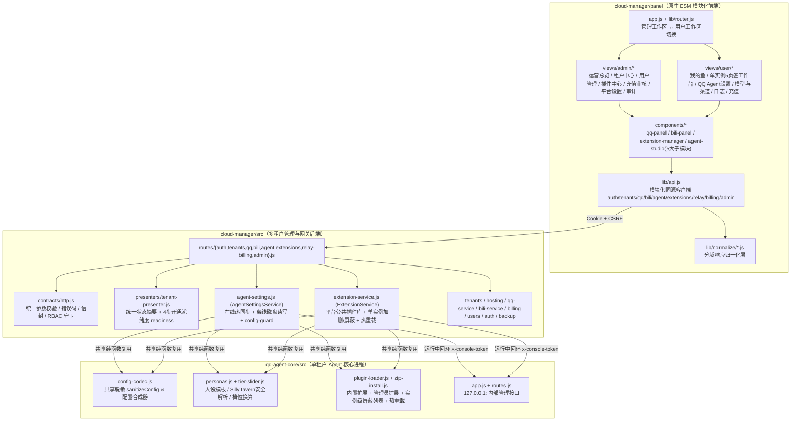

# Fish Cloud 用户视图、管理视图重构与接口规范化 / 核心模块化技术方案

> 文档状态：本地实施与文档同步已完成（2026-10-29）；标准全套验收仍受本机桌面组件缺失阻塞。阶段记录见 [实施进度](view-api-execution.md)，实测结果与边界见 [阶段五验收](view-api-stage-5.md)。
>
> 适用范围：`packages/qq-agent-core`、`packages/cloud-manager/src`、`packages/cloud-manager/panel`
>
> 核心目标：重构普通用户使用视图与管理员运维运营视图，打通同源 QQ Agent 深度自定义设置与**管理员按实例增删插件/技能**能力，统一规范全项目接口契约，并将后端、核心与前端全面模块化。

---

## 目录

1. [背景与现状源码级诊断](#一背景与现状源码级诊断)
2. [总体设计原则与安全边界](#二总体设计原则与安全边界)
3. [核心部分全面模块化架构](#三核心部分全面模块化架构)
4. [管理员按实例增删 QQ Agent 插件/技能架构](#四管理员按实例增删-qq-agent-插件技能架构)
5. [全项目接口规范与完整 API 契约表](#五全项目接口规范与完整-api-契约表)
6. [数据库 Schema 演进设计](#六数据库-schema-演进设计)
7. [普通用户视图重设计（养鱼工作台）](#七普通用户视图重设计养鱼工作台)
8. [管理员管理视图重设计（全景运营与运维台）](#八管理员管理视图重设计全景运营与运维台)
9. [分阶段实施路线图与验收测试矩阵](#九分阶段实施路线图与验收测试矩阵)

---

## 一、背景与现状源码级诊断

项目主链路（创建实例 → NapCat/LLBot 登录 QQ → 自定义/平台模型调用 → 消息收发）已跑通，但在日常管理与普通用户自助使用上存在四类核心瓶颈：

### 1.1 普通用户端：难以使用，无法直接自定义 QQ Agent 设置
- **双控制台割裂与泛子域依赖**：
  - 当前云面板用户实例详情页 `packages/cloud-manager/panel/views/user/instance.js` 仅包含「QQ 内核下拉框、QQ 号输入、扫码登录、切换内核」，**没有任何 QQ Agent 核心设置入口**。
  - 所有 QQ Agent 设置（群聊/私聊白名单、角色人设、SillyTavern 角色卡导入、1~4 档响应触发策略、表情包/主动开话题/活跃模式/指令禁言/联网搜索/记忆管理/工具分类开关）全部留在 `packages/qq-agent-core/ui/` 原单机桌面控制台中，且必须通过 `packages/cloud-manager/src/gateway.js` 的 `<slug>.<baseDomain>` 泛子域访问。
- **真实部署环境与首次开通体验闭锁**：
  - 在公网 IP 部署或未配置泛域名 DNS/HTTPS 时，`Bot 控制台 ↗` 指向的 `<slug>.<baseDomain>` 根本无法打开；且实例未启动时 `Gateway` 直接返回 `503 AGENT_NOT_RUNNING`，用户无法「先配好白名单和人设再启动」。
  - 云端 `packages/cloud-manager/src/config-guard.js` 强制 `allowAllWhenEmpty=false`（空白名单默认不回复任何会话），而用户面板又无法配置群/私聊白名单，导致用户走完「创建实例 → 扫码登录 → 绑定 Key」后，机器人因白名单为空仍然完全不说话。
  - 即便进入原单机 UI，界面仍暴露 `SnowLuma`、`便携 QQ`、`模型 API`（云端已被 `config-guard.js` 锁定）等桌面专属功能，理解成本高。
- **渠道页缺少模型选择与连通性反馈**：
  - `packages/cloud-manager/panel/views/user/channel.js` 平台渠道卡片仅能输入 Relay Key，缺少套餐允许模型的下拉选择器；自定义渠道保存时不校验远端连通性，也不支持拉取可用模型列表。

### 1.2 管理员端：管理链路残缺，缺少实例级插件管控与运营闭环
- **缺少按实例增删 QQ Agent 插件/技能的能力**：
  - 内置插件（`trpg-dice-hook`、`anti-ban-guard`、`bili-watcher`）和技能（`bili-agent-pack`）位于共享包目录，无法直接按单实例卸载；而租户目录又因防普通用户上传恶意 JS 被 `QQ_AGENT_EXTENSION_ISOLATION_CONFIRMED=1` 整体锁死，管理员没有专用安全通道为不同实例按需加装、升级或移除插件。
- **充值审核闭环断裂**：
  - 用户可在 `#/user/billing` 提交充值申请，后端虽有 `POST /api/admin/recharges/:id/confirm`，但**缺少全局充值申请列表与驳回接口**，管理面板也**没有任何充值审核界面**。
- **大量后端已有运维能力在面板无界面**：
  - 平台公共上游配置（`GET/PUT /api/admin/upstream`）、平台级 LLBot 授权配置（`GET/PUT /api/admin/llbot-auth-token`）、QQ 驱动环境预检（`GET /api/qq/drivers`）无页面；
  - 单租户续费/改套餐（`renew` / `PATCH`）、暂停/恢复资格（`suspend` / `resume`）、重启（`restart`）、管理员人工充值/扣款（`relay/topup`）、实时进程日志（`logs` / `qq/logs` / `bili/logs`）、快照备份与恢复（`backup` / `restore`）、成员协作角色管理（`members`）、租户独立 Auth Token（`qq/auth-token`）均无前端入口；
  - 用户管理页 `#/users` 无法禁用/启用账号、重置密码、调整角色或搜索过滤；`#/tenants` 创建租户弹窗甚至无法指定所属用户和套餐；
  - 侧栏同时堆叠管理员菜单（中英文混杂且存在灰态不可点项 `Hosting Center` / `Relay & Billing`）、用户视图菜单和租户长列表。

### 1.3 接口与核心代码：耦合在巨石文件，契约不统一
- `packages/cloud-manager/src/api.js`（820 行）将全部路由注册、状态摘要拼装、Relay 配置重启同步和裸 SQL 混在一个函数内。
- `packages/qq-agent-core/src/app.js`（2635 行）将 `sanitizeConfig` 等配置脱敏逻辑封闭在函数闭包内，`cloud-manager` 无法在离线管理租户 `data/config.json` 时共享同一套配置合并与脱敏规则。
- `packages/cloud-manager/panel` 中 `views/hosting.js`（1118 行）、`lib/normalize.js`（1012 行）、`views/relay.js`（865 行）体积庞大，`lib/api.js` 仅覆盖约一半后端接口且未按业务域模块化。

---

## 二、总体设计原则与安全边界

1. **同源一站式管理，摆脱泛子域强依赖**：
   - 在 `cloud-manager` 新增标准同源 `/api/tenants/:id/agent/*` 与 `/api/tenants/:id/extensions/*` 接口，所有浏览器请求统一走面板同源 Cookie + `X-CSRF-Token` + RBAC 鉴权，公网 IP 或单域名部署开箱即用；同时保留原有 `<slug>.<baseDomain>` Gateway 兼容。
2. **在线热更新 + 离线可预配双模架构**：
   - 实例未启动时可直接安全读写租户 `data/config.json` 与管理员扩展目录；实例运行中时自动通过内部回环 `127.0.0.1:<agentPort>`（携带内部 `x-console-token`）实时热同步配置与重载插件，无需断连重启。
3. **严格分层权限与零秘密回显**：
   - **代码执行边界**：仅平台管理员（`role === 'admin'`）可上传/安装/删除/屏蔽实例插件代码；普通用户（`owner`/`operator`）仅可在管理员允许的插件范围内开关功能与修改安全配置项（`configSchema`），Gateway 原租户自上传入口继续保持默认闭锁。
   - **配置锁定边界**：所有 Agent 配置修改统一经过 `config-guard.js`，强制 `allowAllWhenEmpty=false`、`tools.crossChatSend=false`、`security.allowPrivateImageHosts=false`，锁死 `server`、`channels`、`api.baseUrl`、`api.apiKey` 等云管字段。
   - **秘密脱敏边界**：任何 HTTP API 响应绝不回显明文 `apiKey`、`accessToken`、`authToken`、`cookie`、`server.token`，统一剥离密钥字段并仅输出 `hasXxx` 布尔标记或前缀掩码。
4. **保持技术栈简洁与 100% 向后兼容**：
   - 保持 `panel` 原生 ES Modules + 原生 CSS **零构建、零外部前端框架**架构；
   - 保留现有自动化测试覆盖的全部历史路由与字段契约，确保平滑演进零回归。

---

## 三、核心部分全面模块化架构

### 3.1 模块关系总览



### 3.2 `packages/qq-agent-core` 模块化拆分清单

| 模块路径 | 类型 | 核心职责 |
|---|---|---|
| `src/config-codec.js` | **新增** | 抽离原 `src/app.js` 闭包内的 `sanitizeConfig`、`sanitizeProvider`、`stripDerivedConfigFlags`，并提供无全局副作用的 `normalizeStoredAgentConfig(raw)` 与 `mergeAgentConfigPatch(current, patch)`（统一处理 `contextSliderPos` 与 `contextTier` 双向同步及数组型密钥保留）。 |
| `src/plugin-loader.js` | **增强** | 新增支持扫描 `QQ_AGENT_ADMIN_PLUGINS_DIR` / `QQ_AGENT_ADMIN_SKILLS_DIR`（管理员受信任扩展目录），并支持读取 `<QQ_AGENT_DATA_DIR>/blocked-extensions.json` 按实例屏蔽并卸载指定内置扩展。 |
| `src/app.js` | **重构** | 移除内联重复的脱敏函数，统一从 `src/config-codec.js` 导入，保持单机版、Electron 版与 Headless 版行为完全一致。 |

### 3.3 `packages/cloud-manager/src` 后端模块化目录清单

```text
packages/cloud-manager/src/
├── api.js                         # 精简为纯路由聚合器（< 60 行）
├── app.js                         # 服务装配容器（注入 AgentSettingsService 与 ExtensionService）
├── contracts/
│   └── http.js                    # [新增] httpError、sendOk、parseQueryInt/String/Enum、tenantCtx/requireAdmin
├── presenters/
│   └── tenant-presenter.js        # [新增] 租户/QQ/B站/Relay/Agent 配置摘要 + 4 步就绪度诊断 readiness
├── agent-settings.js              # [新增] 同源 QQ Agent 在线/离线双模配置、人设与角色卡、群/好友拉取、会话/记忆桥接
├── extension-service.js           # [新增] 平台公共插件库管理 + 单实例/批量插件安装、删除、内置屏蔽与热重载
├── routes/
│   ├── auth.js                    # [新增] 登录、登出、/api/me、自助改密 /api/auth/password
│   ├── tenants.js                 # [新增] 套餐、租户 CRUD、启停/重启/续费/暂停恢复、成员、日志、审计、备份恢复
│   ├── qq.js                      # [新增] QQ 驱动、准备/启动/停止/状态、二维码与刷新、内核事务切换、Auth Token
│   ├── bili.js                    # [新增] B 站扫码、状态、订阅与监控目标配置、启停、登出、日志
│   ├── agent.js                   # [新增] /api/tenants/:id/agent/* 全套 QQ Agent 设置与运行管理接口
│   ├── extensions.js              # [新增] /api/tenants/:id/extensions/* 与 /api/admin/extensions/* 插件增删接口
│   ├── relay-billing.js           # [新增] Relay 概览/模型/Key、自定义渠道及连通性测试、调用日志、充值与钱包流水
│   └── admin.js                   # [新增] 平台运营总览、用户全生命周期管理、全局充值审核、平台上游与全局审计
├── db.js                          # 新增 Migration v9（充值驳回状态与审核备注字段）
├── billing.js                     # 新增全局充值筛选列表、驳回申请、钱包流水、平台级运营统计
├── auth.js & users.js             # 新增用户实例计数、管理员启停用户/重置密码/改角色（含最后管理员保护）、自助改密
└── relay/custom-upstreams.js      # 新增 SSRF 保护下的自定义上游 /models 连通性与模型列表探测 probe()
```

### 3.4 `packages/cloud-manager/panel` 前端模块化目录清单

```text
packages/cloud-manager/panel/
├── index.html                     # 语义化壳层：支持管理导航与用户导航清晰切换
├── app.js                         # 顶层会话生命周期、工作区模式切换、自助改密弹窗、路由挂载调度
├── lib/
│   ├── api.js                     # 模块化 API 客户端（按业务域分组 + 100% 后端端点覆盖 + 旧扁平方法兼容）
│   ├── router.js                  # 完整支持管理端与用户端新老哈希路由及角色访问控制
│   ├── normalize.js               # 聚合导出入口（兼容全部旧引用）
│   └── normalize/
│       ├── core.js                # [新增] 基础安全类型转换
│       ├── tenant.js              # [新增] 用户、租户、readiness、成员、备份、审计、运营总览归一化
│       ├── channels.js            # [新增] QQ 与 B 站状态、驱动、二维码、切换事务归一化
│       ├── relay-billing.js       # [新增] Relay、自定义上游测试、账单、流水、充值审核单归一化
│       └── agent.js               # [新增] QQ Agent 配置、白名单、人设/角色卡、档位行为、扩展与会话记忆归一化
├── components/
│   ├── tabs.js                    # [新增] 通用无障碍页签与未保存变更守卫组件
│   ├── qq-panel.js                # [新增] 统一 QQ 接入卡片（user 简洁模式 / admin 高级模式）
│   ├── bili-panel.js              # [新增] 统一 B 站桥接与监控目标配置卡片
│   ├── extension-manager.js       # [新增] 管理员单实例插件增删面板 & 平台插件库批量分发弹窗组件
│   └── agent-studio/              # [新增] 可嵌入用户工作台与管理员租户页的 QQ Agent 核心设置组件群
│       ├── index.js               #        工作台组装入口
│       ├── whitelist-editor.js    #        群/私聊白名单（在线勾选真实群/好友 + 离线批量录入 + 黑名单/群员屏蔽）
│       ├── persona-editor.js      #        人设编辑器（模板库 + SillyTavern JSON/PNG 预览导入 + 分群独立人设）
│       ├── behavior-editor.js     #        响应档位（1~4档 + 关键词 + 峰谷时段）与拟人互动开关
│       ├── capabilities-editor.js #        联网搜索、记忆自动整理、8类工具与可用插件开关、系统提示词预览
│       └── runtime-inspector.js   #        暂停回复开关、最近会话重试/中止、测试发消息、群友印象记忆管理
├── views/
│   ├── login.js                   # 登录页
│   ├── qr.js & qq-switch.js       # 扫码弹窗与内核切换控制器
│   ├── admin/                     # [重构/新增] 管理员全景控制台视图
│   │   ├── overview.js            #   #/admin/overview 运营总览与环境体检
│   │   ├── tenants.js             #   #/tenants 租户搜索/筛选/指定所有者与套餐创建
│   │   ├── tenant-detail.js       #   #/tenants/:id/{hosting,agent,extensions,relay,ops} 单租户 5 页签全能中心
│   │   ├── users.js               #   #/users & #/users/:id/instances 用户搜索/启停/改密/改角色/名下实例
│   │   ├── extensions.js          #   #/admin/extensions 平台公共插件库与多实例批量分发/卸载
│   │   ├── recharges.js           #   #/admin/recharges 全局充值审核台（确认到账 / 填写原因驳回）
│   │   ├── platform.js            #   #/admin/platform 平台上游、LLBot 授权与 QQ 驱动预检
│   │   └── audit.js               #   #/admin/audit 全平台审计日志检索
│   └── user/                      # [重构/新增] 普通用户养鱼工作台视图
│       ├── shared.js              #   多实例选择器与空实例引导
│       ├── instances.js           #   #/user/instances 我的鱼卡片 + 4 步开通就绪度进度
│       ├── instance.js            #   #/user/instances/:id 单实例 5 页签一站式工作台
│       ├── agent.js               #   #/user/agent 顶层快捷 QQ Agent 设置入口
│       ├── channel.js             #   #/user/channel 平台套餐模型选择 + 自定义上游测试与拉取模型
│       ├── logs.js                #   #/user/logs 调用日志筛选与会话费用摘要
│       └── billing.js             #   #/user/billing 钱包余额、充值申请、审核进度/驳回原因、收支流水
└── styles/
    └── workspace.css              # [新增] 工作台页签、向导条、筛选表格、标签输入、角色卡与插件卡片样式
```

---

## 四、管理员按实例增删 QQ Agent 插件/技能架构

### 4.1 三层扩展存储与实例隔离模型

为彻底解决「既要禁止普通租户上传任意 JS，又要允许管理员灵活给不同实例加装或移除插件（含内置插件）」的矛盾，采用**三层扩展目录 + 实例级屏蔽表**设计：

```text
<CLOUD_DATA_DIR>/
├── extensions/
│   └── catalog/
│       ├── plugins/<ext-id>/                # 平台公共插件库（确定性型：plugin.json + 源码）
│       └── skills/<ext-id>/                 # 平台公共技能库（LLM 工具型：skill.json + 源码）
└── tenants/<tenant-id>/
    ├── admin-extensions/
    │   ├── plugins/<ext-id>/                # [管理员专属写] 该实例单独安装的插件（Agent 默认信任加载）
    │   └── skills/<ext-id>/                 # [管理员专属写] 该实例单独安装的技能（Agent 默认信任加载）
    ├── data/
    │   ├── config.json                      # 该实例各插件的开关与 settings 配置
    │   └── blocked-extensions.json          # [管理员专属写] 该实例被移除/屏蔽的扩展 ID 列表（如 ["trpg-dice-hook"]）
    └── extensions/{plugins,skills}/         # 原租户自上传目录（继续受 ISOLATION_CONFIRMED=1 保护，默认关闭）
```

### 4.2 加载优先级与加删生命周期

1. **加载顺序与覆盖规则（`plugin-loader.js`）**：
   - 第一步：读取 `<QQ_AGENT_DATA_DIR>/blocked-extensions.json` 构建 `blockedSet`。任何 ID 命中 `blockedSet` 的内置扩展不导入、不注册，若此前已加载则通过 `pruneMissing` 立即执行 `deactivate() → dispose() → unregisterToolsBySkill()`。
   - 第二步：加载未被屏蔽的包内内置扩展（`packages/qq-agent-core/{plugins,skills}`）。
   - 第三步：加载管理员为该实例安装的 `admin-extensions/{plugins,skills}`（若与内置扩展同 ID，管理员安装版本自动覆盖该实例的内置版本，不影响其他实例）。
   - 第四步：仅当部署者显式开启 `QQ_AGENT_EXTENSION_ISOLATION_CONFIRMED=1` 时，才扫描租户自上传目录。
2. **管理员添加插件的两种方式**：
   - **直接给单实例上传 `.zip`**：经过 `zip-install.js` 严格安全校验（禁止路径穿越 `..`、禁止符号链接、禁止 `.exe/.sh/.bat/.dll` 等危险后缀、校验单文件 ≤ 8 MiB / 总解压 ≤ 32 MiB / 压缩比防炸弹 / CRC32 完整性、校验 `plugin.json` 或 `skill.json` 清单及入口相对路径），原子解压到 `staging` → 备份旧版 → 移入 `tenants/<id>/admin-extensions/{plugins|skills}/<extId>`（若该 ID 曾在 `blocked-extensions.json` 中则自动移出屏蔽列表）。
   - **从平台公共插件库一键下发（单实例或批量多实例）**：管理员先在「插件中心」将常用插件上传至 `extensions/catalog/`，随后可一键勾选任意一批实例分发安装或批量升级，无需逐个实例重复上传 ZIP。
3. **管理员删除插件的两种语义**：
   - **删除管理员安装的扩展**：物理删除 `tenants/<id>/admin-extensions/{plugins|skills}/<extId>`；若同名内置扩展存在，可选择「回退至内置原版」或「同时屏蔽内置版」；可选同步清除 `config.json` 中 `skills.<extId>` 配置残留。
   - **删除（移除）某实例的内置扩展**：将该内置扩展 ID 写入该实例 `blocked-extensions.json`，其他实例不受影响；普通用户端立即隐藏该扩展且禁止通过 API 重新启用（返回 `403 EXTENSION_BLOCKED_BY_ADMIN`）；管理员可随时点击「恢复内置插件」解除屏蔽。
4. **免重启热生效与失败自动回滚**：
   - 若目标实例 Agent 正在运行，`ExtensionService` 自动调用内部回环 `POST /api/skills/reload`；若新安装插件 `reload` 报告 `loadError`，自动回滚恢复旧目录并再次 `reload`，保证线上运行中的机器人绝不因坏包宕机。

---

## 五、全项目接口规范与完整 API 契约表

### 5.1 统一接口设计规范
- **鉴权与防跨站**：所有 `/api/*` 面板接口统一校验 `HttpOnly` 会话 Cookie；所有写请求（`POST` / `PUT` / `PATCH` / `DELETE`）强制校验 `X-CSRF-Token`（或同源 `Origin` 证据）并拒绝 `Sec-Fetch-Site: cross-site`。
- **角色模型**：
  - 平台角色：`admin`（跨全部租户最高权限 + `/api/admin/*` 与扩展增删权限）、`user`（普通用户）。
  - 租户成员角色：`owner`（所有者：计费/渠道/成员/备份/续费 + 全部操作员权限） > `operator`（操作员：启停/扫码/QQ Agent 设置与开关） > `viewer`（只读成员：仅 `GET` 查看状态与配置）。
- **响应与错误契约**：
  - 成功响应：统一 JSON `{ "ok": true, ...领域数据 }`，HTTP 状态码新建资源用 `201`，异步切换/整理任务用 `202`，其余 `200`。
  - 错误响应：统一 JSON `{ "ok": false, "code": "UPPER_SNAKE_CODE", "error": "中文可读错误说明" }`，HTTP 状态码严格区分 `400`（参数错误）、`401`（未登录）、`402`（实例到期或余额不足）、`403`（权限不足/CSRF/管理员已禁用）、`404`（资源不存在）、`409`（状态冲突/切换进行中）、`413`（请求体超限）、`429`（限流）、`502/503/504`（下游进程未就绪或超时）。

### 5.2 全项目标准 API 清单

> 标记说明：`[保留]` 为现有接口规范化归档（100% 兼容现有字段），`[新增]` 为本次补齐的标准接口。

#### 5.2.1 认证、会话与公共目录（`routes/auth.js`、`routes/tenants.js`、`routes/qq.js`）
| 状态 | 方法 | 路径 | 权限 | 说明 |
|---|---|---|---|---|
| `[保留]` | `GET` | `/healthz`、`/api/health` | 公开 | 服务健康检查 |
| `[保留]` | `POST` | `/api/auth/login` | 公开 | 账号密码登录，签发 Cookie 与 `csrfToken` |
| `[保留]` | `POST` | `/api/auth/logout` | 登录 | 注销当前会话并清理 Cookie |
| `[保留]` | `GET` | `/api/me` | 登录 | 当前用户信息、`csrfToken` 与可访问实例摘要列表（含 `readiness`） |
| `[新增]` | `PUT` | `/api/auth/password` | 登录 | 当前用户修改自身密码 `{ currentPassword, newPassword }`，自动吊销其他旧会话 |
| `[保留]` | `GET` | `/api/plans` | 登录 | 获取平台套餐目录与配额说明 |
| `[保留]` | `GET` | `/api/qq/drivers` | 登录 | 获取平台允许的 QQ 协议驱动、默认驱动及环境可用性原因 |

#### 5.2.2 租户生命周期、成员协作与备份（`routes/tenants.js`）
| 状态 | 方法 | 路径 | 权限 | 说明 |
|---|---|---|---|---|
| `[保留]` | `GET` | `/api/tenants` | 登录 | 获取当前用户可访问的实例列表（管理员返回全平台实例） |
| `[保留]` | `POST` | `/api/tenants` | 登录 | 创建实例 `{ name, slug?, planId?, ownerUserId? }`（仅 `admin` 可指定 `ownerUserId` / `days`） |
| `[保留]` | `GET` | `/api/tenants/:id` | `viewer` | 获取单实例完整摘要、运行态、成员列表与备份列表 |
| `[保留]` | `PATCH` | `/api/tenants/:id` | `owner` | 修改实例名称或套餐（面板补齐 UI） |
| `[保留]` | `POST` | `/api/tenants/:id/start` | `operator` | 启动实例（要求实例未到期且未暂停） |
| `[保留]` | `POST` | `/api/tenants/:id/stop` | `operator` | 停止实例 |
| `[保留]` | `POST` | `/api/tenants/:id/restart` | `operator` | 重启实例（面板补齐 UI） |
| `[保留]` | `POST` | `/api/tenants/:id/renew` | `owner` | 实例续费/延长天数/变更套餐（仅 `admin` 可传自定义 `creditMicros`，面板补齐 UI） |
| `[保留]` | `POST` | `/api/tenants/:id/suspend` | `admin` | 暂停违规或异常租户并停止其运行进程（面板补齐 UI） |
| `[保留]` | `POST` | `/api/tenants/:id/resume` | `admin` | 恢复被暂停的租户为 `active`（面板补齐 UI） |
| `[保留]` | `GET` | `/api/tenants/:id/logs` | `operator` | 读取运行日志 `?kind=all\|agent\|qq\|bili&limit=100`（面板补齐日志查看器） |
| `[保留]` | `GET` | `/api/tenants/:id/audit` | `operator` | 读取单实例审计记录（面板补齐 UI） |
| `[保留]` | `GET` | `/api/tenants/:id/members` | `viewer` | 获取实例协作成员列表 |
| `[保留]` | `POST` | `/api/tenants/:id/members` | `owner` | 添加或修改协作成员 `{ username\|userId, role: 'operator'\|'viewer' }`（面板补齐 UI） |
| `[保留]` | `DELETE` | `/api/tenants/:id/members/:userId` | `owner` | 移除协作成员（owner 不可移除，面板补齐 UI） |
| `[保留]` | `GET` | `/api/tenants/:id/backups` | `viewer` | 获取实例加密备份列表 |
| `[保留]` | `POST` | `/api/tenants/:id/backup` | `owner` | 创建实例加密快照备份（面板补齐 UI） |
| `[保留]` | `POST` | `/api/tenants/:id/restore` | `owner` | 从指定 `backupId` 恢复实例数据与密钥（面板补齐 UI） |

#### 5.2.3 QQ 协议接入与 B 站桥接（`routes/qq.js`、`routes/bili.js`）
| 状态 | 方法 | 路径 | 权限 | 说明 |
|---|---|---|---|---|
| `[保留]` | `POST` | `/api/tenants/:id/qq/prepare` | `operator` | 准备 QQ 协议端配置 `{ uin, driver?, mode?, pmhqPort?, authToken? }` |
| `[保留]` | `POST` | `/api/tenants/:id/qq/start` | `operator` | 按需准备并启动 QQ 协议端 |
| `[保留]` | `POST` | `/api/tenants/:id/qq/stop` | `operator` | 停止 QQ 协议端 |
| `[保留]` | `GET` | `/api/tenants/:id/qq/status` | `viewer` | 获取 QQ 运行环境、登录态、Agent 通道连接与 `canChat` 状态 |
| `[保留]` | `GET` | `/api/tenants/:id/qq/qrcode` | `operator` | 获取登录二维码图片与运行代次 |
| `[保留]` | `POST` | `/api/tenants/:id/qq/qrcode/refresh` | `operator` | NapCat 未登录会话换取新二维码 |
| `[保留]` | `POST` | `/api/tenants/:id/qq/switch` | `operator` | 发起 P2 事务式 QQ 内核切换 |
| `[保留]` | `GET` | `/api/tenants/:id/qq/operations/:opId` | `viewer` | 只读查询切换事务状态 |
| `[保留]` | `POST` | `/api/tenants/:id/qq/operations/:opId/advance` | `operator` | 检查登录并推进切换事务 |
| `[保留]` | `POST` | `/api/tenants/:id/qq/operations/:opId/cancel` | `operator` | 安全取消切换事务并按状态回滚 |
| `[保留]` | `PUT / DELETE` | `/api/tenants/:id/qq/auth-token` | `operator` | 设置或清除单实例 LLBot Direct Auth Token（管理面板补齐 UI） |
| `[保留]` | `GET` | `/api/tenants/:id/qq/logs` | `operator` | 读取脱敏后的 QQ 协议端/容器日志 |
| `[保留]` | `POST` | `/api/tenants/:id/bili/login/qr` | `operator` | 启动桥接并创建 B 站扫码 |
| `[保留]` | `GET` | `/api/tenants/:id/bili/login/status` | `viewer` | 轮询 B 站扫码绑定状态 |
| `[保留]` | `GET` | `/api/tenants/:id/bili/status` | `viewer` | 获取 B 站账号、Cookie 健康度、轮询与直播状态 |
| `[保留]` | `GET / PUT` | `/api/tenants/:id/bili/config` | `viewer` / `operator` | 读取或更新 B 站四类订阅开关及监控 `upMids`/`videos`/`liveRoomIds` |
| `[保留]` | `POST` | `/api/tenants/:id/bili/{start,stop,logout}` | `operator` | 启动、停止 B 站桥接或退出 B 站账号 |
| `[保留]` | `GET` | `/api/tenants/:id/bili/logs` | `operator` | 读取 B 站桥接运行日志 |

#### 5.2.4 同源 QQ Agent 配置、人设角色卡与运行控制（`routes/agent.js`，全新模块）
| 状态 | 方法 | 路径 | 权限 | 说明 |
|---|---|---|---|---|
| `[新增]` | `GET` | `/api/tenants/:id/agent/config` | `viewer` | 读取脱敏后的 QQ Agent 完整配置、`agentRunning` 与云端锁定字段清单（在线/离线通用） |
| `[新增]` | `PATCH` | `/api/tenants/:id/agent/config` | `operator` | 更新白名单、黑名单、群员屏蔽、人设、分群人设、响应档位、关键词、峰谷、表情包、主动话题、活跃模式、指令禁言、联网搜索、记忆整理、工具分类开关（兼容 `PUT`；必过 `config-guard`；在线热更新 / 离线写盘） |
| `[新增]` | `GET` | `/api/tenants/:id/agent/personas` | `viewer` | 获取内置（小鲸鱼等）与租户自定义人设模板列表及当前生效人设 |
| `[新增]` | `POST` | `/api/tenants/:id/agent/personas` | `operator` | 新建保存自定义人设模板 `{ name, text, customRules?, applyNow? }` |
| `[新增]` | `DELETE` | `/api/tenants/:id/agent/personas/:templateId` | `operator` | 删除 `custom_*` 自定义人设模板 |
| `[新增]` | `POST` | `/api/tenants/:id/agent/persona-cards/preview` | `operator` | 预览 SillyTavern JSON/PNG 角色卡（上限 8 MiB），返回解析摘要与安全过滤警告，不落盘 |
| `[新增]` | `POST` | `/api/tenants/:id/agent/persona-cards/import` | `operator` | 安全导入角色卡至 `customPersonas`（自动剥离 `system_prompt` / 世界书 / `assets`），支持 `applyNow: true` 一键应用 |
| `[新增]` | `GET` | `/api/tenants/:id/agent/contacts` | `viewer` | 拉取已登录 QQ 的真实群列表 `groups` 与好友列表 `friends` 供白名单勾选；离线时优雅返回 `{ online: false, groups: [], friends: [] }` |
| `[新增]` | `GET` | `/api/tenants/:id/agent/status` | `viewer` | 获取 Agent 进程健康度、OneBot 诊断、是否暂停 `paused` 与今日会话用量 |
| `[新增]` | `PUT` | `/api/tenants/:id/agent/pause` | `operator` | 暂停或恢复机器人发言 `{ paused, clearUnread?, skipBacklog? }` |
| `[新增]` | `GET` | `/api/tenants/:id/agent/sessions` | `viewer` | 获取最近 Agent 会话触发与执行记录 |
| `[新增]` | `POST` | `/api/tenants/:id/agent/sessions/clear-finished` | `operator` | 清空已结束的历史会话记录 |
| `[新增]` | `POST` | `/api/tenants/:id/agent/sessions/:sessionId/:action` | `operator` | 单条会话控制：`retry`（重试失败会话）/ `abort`（中止运行中会话）/ `delete` |
| `[新增]` | `GET` | `/api/tenants/:id/agent/chats` | `viewer` | 获取已有消息存档的会话列表 |
| `[新增]` | `GET` | `/api/tenants/:id/agent/chats/:chatId/messages` | `viewer` | 分页读取指定群/私聊存档消息 |
| `[新增]` | `POST` | `/api/tenants/:id/agent/chats/:chatId/actions` | `operator` | 执行会话动作：`test-send`（向白名单会话发测试消息）、`mark-read`、`mute`、`clear` |
| `[新增]` | `GET` | `/api/tenants/:id/agent/memories` | `viewer` | 获取各群/私聊记忆文件概览与整理状态 |
| `[新增]` | `GET` | `/api/tenants/:id/agent/memories/:chatId` | `viewer` | 查看指定会话的群友印象记忆详情 |
| `[新增]` | `PUT` | `/api/tenants/:id/agent/memories/:chatId/members/:userId` | `operator` | 手动编辑某位群友的备注与印象条目 |
| `[新增]` | `DELETE` | `/api/tenants/:id/agent/memories/:chatId` | `operator` | 清空整个会话的记忆（另支持 `.../members/:userId` 删除单人印象） |
| `[新增]` | `POST` | `/api/tenants/:id/agent/memories/consolidate` | `operator` | 手动触发指定会话的记忆合并去重整理 |
| `[新增]` | `GET` | `/api/tenants/:id/agent/skills` | `viewer` | 获取 8 大工具分类、各工具可用性诊断以及该实例**未被管理员屏蔽**的扩展状态 |
| `[新增]` | `PATCH` | `/api/tenants/:id/agent/skills/:skillId` | `operator` | 启停该实例可用扩展，或更新其 `configSchema` 安全参数（被管理员屏蔽的扩展拒绝操作） |
| `[新增]` | `POST` | `/api/tenants/:id/agent/prompt-preview` | `viewer` | 预览当前人设与工具开关组合生成的完整系统提示词 |

#### 5.2.5 实例级插件增删与平台公共插件库（`routes/extensions.js`，全新模块）
| 状态 | 方法 | 路径 | 权限 | 说明 |
|---|---|---|---|---|
| `[新增]` | `GET` | `/api/tenants/:id/extensions` | `viewer` / `admin` | 获取该实例扩展清单（`admin` 可见已装自定义扩展、内置扩展及 `blocked` 已屏蔽内置扩展；普通成员仅可见当前允许使用的扩展） |
| `[新增]` | `POST` | `/api/tenants/:id/extensions/install-zip` | **`admin`** | 上传 `.zip`（`base64`，≤ 8 MiB）安装或升级该实例的插件/技能，运行中自动热重载，失败自动回滚 |
| `[新增]` | `POST` | `/api/tenants/:id/extensions/install-catalog` | **`admin`** | 从平台公共插件库指定 `{ extId }` 一键安装/更新到该实例 |
| `[新增]` | `DELETE` | `/api/tenants/:id/extensions/:extId` | **`admin`** | 从该实例删除插件：自定义扩展物理卸载目录（支持 `?cleanConfig=1`）；内置扩展写入该实例 `blocked-extensions.json` 并立即热卸载 |
| `[新增]` | `POST` | `/api/tenants/:id/extensions/:extId/restore` | **`admin`** | 恢复该实例此前被管理员移除/屏蔽的内置扩展 |
| `[新增]` | `POST` | `/api/tenants/:id/extensions/reload` | **`admin`** | 强制触发运行中实例重扫扩展目录并热重载 |
| `[新增]` | `GET` | `/api/admin/extensions/catalog` | **`admin`** | 获取平台公共插件库列表及每个插件已分发的实例统计 |
| `[新增]` | `POST` | `/api/admin/extensions/catalog` | **`admin`** | 上传 `.zip` 新增或更新平台公共插件库条目 |
| `[新增]` | `DELETE` | `/api/admin/extensions/catalog/:extId` | **`admin`** | 从平台公共插件库删除条目 |
| `[新增]` | `POST` | `/api/admin/extensions/catalog/:extId/deploy` | **`admin`** | 批量下发：传入 `{ tenantIds: [...] }` 一键安装/升级到多个实例 |
| `[新增]` | `POST` | `/api/admin/extensions/catalog/:extId/undeploy` | **`admin`** | 批量移除：传入 `{ tenantIds: [...] }` 一键从多个实例卸载/屏蔽该插件 |

#### 5.2.6 模型中转、计费与钱包（`routes/relay-billing.js`）
| 状态 | 方法 | 路径 | 权限 | 说明 |
|---|---|---|---|---|
| `[保留]` | `GET` | `/api/tenants/:id/relay/overview` | `viewer` | 获取 Relay Key 状态、生效模型、套餐配额、钱包余额与按日/模型/会话用量账单 |
| `[保留]` | `GET` | `/api/tenants/:id/relay/models` | `viewer` | 获取套餐允许的模型列表与上游探测状态 |
| `[保留]` | `PUT` | `/api/tenants/:id/relay/key` | `owner` | 绑定/轮换平台 Relay Key 或切换套餐默认模型 `{ key?, model? }` |
| `[保留]` | `GET / PUT / DELETE` | `/api/tenants/:id/relay/custom` | `viewer` / `owner` | 读取、保存或删除自定义 OpenAI 兼容上游 `{ baseUrl, apiKey?, model }` |
| `[新增]` | `POST` | `/api/tenants/:id/relay/custom/test` | `owner` | SSRF 安全校验下探测自定义上游 `/models`，返回连通状态、延迟与远端可用模型清单 |
| `[保留]` | `GET` | `/api/tenants/:id/relay/logs` | `viewer` | 筛选调用日志 `?days=7&limit=100&model=&status=` |
| `[保留]` | `POST` | `/api/tenants/:id/relay/topup` | `admin` | 管理员手工为实例钱包充值或扣减微元 `{ amountMicros, note }`（面板补齐 UI） |
| `[保留]` | `GET / POST` | `/api/tenants/:id/billing/recharges` | `viewer` / `owner` | 查看本实例充值申请列表或提交新充值申请 `{ amountMicros }` |
| `[新增]` | `GET` | `/api/tenants/:id/billing/transactions` | `viewer` | 查询本实例钱包收支流水明细（初始赠送、续费赠送、充值到账、管理员调整） |

#### 5.2.7 平台管理员运营与系统配置（`routes/admin.js`）
| 状态 | 方法 | 路径 | 权限 | 说明 |
|---|---|---|---|---|
| `[新增]` | `GET` | `/api/admin/overview` | `admin` | 平台运营总览：租户各状态计数、用户统计、待审核充值笔数与金额、今日/7日平台调用与消耗、上游及 QQ 驱动健康度 |
| `[保留]` | `GET / POST` | `/api/admin/users` | `admin` | 查询所有用户（新增返回 `tenantCount` 拥有实例数）或创建用户 |
| `[新增]` | `PATCH` | `/api/admin/users/:userId` | `admin` | 更新用户 `{ disabled?, role?, password? }`：支持禁用/启用账号（禁用立即清理会话）、重置密码、变更角色（内置最后活跃管理员防误锁保护） |
| `[保留]` | `GET` | `/api/admin/users/:userId/tenants` | `admin` | 查询指定用户拥有的实例摘要列表 |
| `[新增]` | `GET` | `/api/admin/recharges` | `admin` | 全局充值订单列表 `?status=pending\|confirmed\|rejected\|all&tenantId=&limit=100`（关联租户名与申请人） |
| `[保留]` | `POST` | `/api/admin/recharges/:id/confirm` | `admin` | 确认充值订单并入账（扩展支持可选 `{ note }` 审核备注） |
| `[新增]` | `POST` | `/api/admin/recharges/:id/reject` | `admin` | 驳回待审核充值申请 `{ note }` 并记录审核人与时间 |
| `[保留]` | `GET / PUT` | `/api/admin/upstream` | `admin` | 查看或配置平台公共模型上游 `{ baseUrl, apiKey?, clear? }`（面板补齐 UI） |
| `[保留]` | `GET / PUT` | `/api/admin/llbot-auth-token` | `admin` | 查看状态或配置平台级 LLBot Direct 登录授权 Token（面板补齐 UI） |
| `[保留]` | `GET` | `/api/admin/audit` | `admin` | 全局安全与操作审计检索（扩展支持 `?tenantId=&actorUserId=&action=&limit=` 并关联用户名/租户名） |

---

## 六、数据库 Schema 演进设计

在 `packages/cloud-manager/src/db.js` 新增 **Migration Version 9**，无损升级 `recharges` 表以支持管理员充值审核闭环（确认到账 + 驳回及原因记录），同时确保内存单测局部表迁移安全：

```sql
-- Migration v9: 扩展充值订单表支持 rejected 状态与审核元数据
CREATE TABLE recharges_v9 (
  id TEXT PRIMARY KEY,
  tenant_id TEXT NOT NULL REFERENCES tenants(id) ON DELETE CASCADE,
  amount_micros INTEGER NOT NULL CHECK (amount_micros > 0),
  status TEXT NOT NULL DEFAULT 'pending' CHECK (status IN ('pending', 'confirmed', 'rejected')),
  created_by_user_id TEXT NOT NULL REFERENCES users(id),
  confirmed_by_user_id TEXT REFERENCES users(id),
  reviewed_by_user_id TEXT REFERENCES users(id),
  review_note TEXT,
  created_at INTEGER NOT NULL,
  confirmed_at INTEGER,
  reviewed_at INTEGER
);

INSERT INTO recharges_v9 (
  id, tenant_id, amount_micros, status, created_by_user_id, confirmed_by_user_id,
  reviewed_by_user_id, review_note, created_at, confirmed_at, reviewed_at
)
SELECT
  id, tenant_id, amount_micros, status, created_by_user_id, confirmed_by_user_id,
  confirmed_by_user_id, NULL, created_at, confirmed_at, confirmed_at
FROM recharges;

DROP TABLE recharges;
ALTER TABLE recharges_v9 RENAME TO recharges;
CREATE INDEX IF NOT EXISTS idx_recharges_tenant_created ON recharges(tenant_id, created_at);
CREATE INDEX IF NOT EXISTS idx_recharges_pending ON recharges(status, created_at);
```

> 说明：实例级插件文件与 `blocked-extensions.json` 直接存放在租户目录 `tenants/<id>/` 下，天然纳入现有 `BackupService` 的 AES-256-GCM 租户快照备份与恢复范围，无需额外耦合 SQLite 表。

---

## 七、普通用户视图重设计（养鱼工作台）

### 7.1 用户端信息架构
普通用户登录后直接进入纯净的「养鱼工作台」，完全不展示任何管理后台入口或底层端口配置：

```text
用户侧栏
├── 我的鱼 (#/user/instances)            → 实例卡片列表 + 4 步就绪度进度 + 新建/启停
│   └── 实例工作台 (#/user/instances/:id) → 5 页签一站式配置（接入 / 白名单 / 人设 / 档位与能力 / 会话与记忆）
├── QQ Agent 设置 (#/user/agent)         → 顶部实例切换器 + 直达当前实例的 QQ Agent 核心设置面板
├── 模型与渠道 (#/user/channel)          → 平台套餐模型选择 + 自定义上游配置与一键测试拉取模型
├── 用量与日志 (#/user/logs)             → 调用记录筛选 + 按日/按群消耗统计
└── 钱包与充值 (#/user/billing)          → 余额概览 + 提交充值 + 审核状态/驳回说明 + 钱包流水 + 套餐续费
底部账号栏：当前用户名 · 修改密码 · 退出登录
```

### 7.2 顶部「4 步开通就绪度向导（Readiness Checklist）」
在实例卡片与实例工作台顶部实时展示 4 步诊断状态，消除用户「不知道差哪一步」的困惑：
1. **启动实例**：Agent 宿主进程是否运行中（未运行 → 提供「立即启动」按钮）；
2. **扫码登录 QQ**：QQ 协议端是否已在线且账号匹配（未登录 → 一键定位扫码区）；
3. **模型渠道可用**：自定义渠道已填妥或平台渠道余额充足（未就绪 → 一键跳渠道配置）；
4. **选择互动白名单**：`allow.groups` 或 `allow.private` 至少配置了 1 个群或好友（为空时醒目提示「当前白名单为空，机器人不会在任何群开口」，点击直达「群聊与白名单」页签）。

### 7.3 单实例工作台 5 大模块化页签详细设计（`#/user/instances/:tenantId`）

| 页签 | 包含模块与用户可自定义项 | 对应 `qq-agent-core` 配置字段 |
|---|---|---|
| **1. 概览与扫码接入** | 实例启动/停止/重启；**机器人暂停回复开关**（临时闭嘴不断开 QQ）；QQ 号录入与扫码登录（默认平台推荐内核，高级内核切换折叠收纳）；B 站扫码绑定与四类订阅开关。 | `/qq/*`、`/bili/*`、`/agent/pause` |
| **2. 群聊与白名单** | **在线勾选**：QQ 在线时一键拉取真实群列表与好友列表，支持搜索群名/群号、勾选加入白名单；<br>**离线手动录入**：支持逗号/换行批量粘贴群号与私聊 QQ 号；<br>**黑名单与群内屏蔽**：黑名单群/私聊、指定群内忽略某位群成员发言。 | `allow.groups`、`allow.private`、`deny.groups`、`deny.private`、`blocklist` |
| **3. 人设与角色卡** | **基础身份**：机器人名字（如 `小鲸鱼`）、群内展示昵称、发言参与度（低/中/高）；<br>**模板库**：一键套用内置「小鲸鱼（默认）」或自定义模板，支持将当前设定另存为模板；<br>**SillyTavern 角色卡导入**：上传 `.json`/`.png` 角色卡 → 弹窗预览描述与安全过滤提示 → 一键导入并应用；<br>**人设正文与追加规则**；<br>**分群独立人设**：关闭统一人设后，可为不同白名单群单独设置性格与规则。 | `persona.botName`、`persona.selfNickname`、`persona.participation`、`persona.roleText`、`persona.customRules`、`customPersonas`、`personaUnified`、`personaByChat` |
| **4. 响应档位与能力** | **4 档触发模式卡片**：<br>· `1 档` 仅被 `@` 时回复（最省额度）<br>· `2 档` 被 `@` + 命中自定义关键词回复（可视化关键词标签增删）<br>· `3 档` 被 `@` + 关键词 + 随机概率接话（0~100% 滑条）<br>· `4 档` 全量消息由模型自主判断是否接话<br>**上下文与时段**：读取历史条数 `historyCount`、峰谷时段自动切档、分群独立档位；<br>**拟人互动**：表情包发送与偷图收藏（含积极度 0~3 档）、冷场主动开话题、活跃话题持续跟聊、`@机器人 /安静` 临时禁言指令；<br>**工具与可用插件**：联网搜索开关、记忆自动整理开关、8 大工具分类开关、**管理员为该实例开放的插件/技能开关与参数表单**、系统提示词实时预览。 | `store.contextTier`、`store.contextSliderPos`、`store.keywords`、`store.randomPercent`、`store.historyCount`、`store.peakSchedule`、`store.unifiedTier`、`store.groupSliderPos`、`sticker.*`、`proactive.*`、`chatActive.*`、`commandMute.*`、`webSearch.enabled`、`memory.consolidateEnabled`、`tools.enabled`、`tools.categories.*`、`skills.*` |
| **5. 会话、记忆与备份** | **最近会话运行记录**：查看触发原因与状态，失败会话重试、运行中会话中止、白名单会话发送测试消息；<br>**群友印象记忆**：按群查看机器人记住的群友印象、手动修改/删除或触发记忆整理；<br>**数据快照**：创建备份与恢复。 | `/agent/sessions/*`、`/agent/chats/*`、`/agent/memories/*`、`/backup`、`/restore` |

---

## 八、管理员管理视图重设计（全景运营与运维台）

### 8.1 管理员导航结构与视角切换
管理员登录后默认进入「平台管理台」，侧栏底部提供 **「切换至用户视角 / 返回平台管理台」** 切换器，彻底告别两套菜单混排：

```text
平台管理侧栏
├── 1. 运营总览 (#/admin/overview)       → 全局核心指标、待审充值提醒、上游与 QQ 驱动健康体检
├── 2. 租户管理 (#/tenants)              → 多维搜索/筛选、指定用户与套餐创建实例
│   └── 单租户管理中心 (#/tenants/:id/*) → 5 页签（通道托管 / QQ Agent配置 / 插件与技能 / 中转与计费 / 日志成员与备份）
├── 3. 用户管理 (#/users)                → 用户搜索、创建、启用/禁用、重置密码、角色切换、名下实例管理
├── 4. 插件中心 (#/admin/extensions)     → 平台公共插件库上传维护 + 多实例批量下发/升级/卸载
├── 5. 充值审核 (#/admin/recharges)      → 待审订单角标、一键确认到账、填写原因驳回
├── 6. 平台设置 (#/admin/platform)       → 平台公共模型上游配置、平台 LLBot Auth Token、驱动预检详情
└── 7. 审计日志 (#/admin/audit)          → 按租户、操作人、动作检索全平台审计轨迹
```

### 8.2 管理员核心模块设计要点

1. **运营总览（`#/admin/overview`）**：
   - 顶部指标条：租户总数 / 运行中 / 已对话就绪 / 3 天内即将到期 / 已暂停、注册用户总数、待审核充值笔数与待审金额、今日与近 7 日平台 Token 消耗及账单金额。
   - 待办与异常提醒：存在待审充值或驱动预检异常（如 NapCat 镜像未就绪、平台上游未配置）时直接高亮操作入口。
2. **租户管理与单租户 5 页签全能中心（`#/tenants` & `#/tenants/:id/*`）**：
   - **租户列表页**：支持按「租户名 / 子域 slug / QQ 号 / 所属用户名」实时搜索，按状态（`全部 / 运行中 / 已停止 / 已暂停 / 已到期`）和套餐（`trial / starter / pro`）过滤；新建租户弹窗支持选择**所属用户**、**套餐**与**初始服务天数**。
   - **单租户详情页顶栏**：集中提供 **启动 / 停止 / 重启 / 续费与改套餐 / 暂停资格 (`suspend`) 与恢复 (`resume`)**。
   - **Tab 1 · 通道托管（`#/tenants/:id/hosting`）**：复用 `qq-panel` 管理员模式（支持 LLBot `direct`/`desktop` 模式、PMHQ 端口、单租户 Auth Token 配置、P2 内核切换）与 `bili-panel`（含监控 UP MID / 视频 / 直播间配置）。
   - **Tab 2 · QQ Agent 配置（`#/tenants/:id/agent`）**：直接挂载 `agent-studio` 组件群，管理员无需 SSH 上服务器手改 JSON 或 curl，即可直接在后台查看或帮用户调整群白名单、人设、响应档位与暂停开关。
   - **Tab 3 · 插件与技能（`#/tenants/:id/extensions`）**：
     - 展示该实例全部 `Plugins`（确定性插件）与 `Skills`（LLM 工具技能），标注来源（`内置` / `管理员安装` / `已从本实例屏蔽`）、版本、声明权限与加载状态；
     - 支持 **「从平台插件库添加」**、**「直接上传 ZIP 安装/覆盖」**、**「删除/从本实例移除」**（自定义插件物理卸载，内置插件按实例屏蔽隐藏）、**「恢复内置插件」** 与 **「立即热重载」**。
   - **Tab 4 · 中转与计费（`#/tenants/:id/relay`）**：Relay Key 签发与轮换、默认模型、自定义上游状态查看、**管理员直接人工充值/扣款 (`topup`) 弹窗**、钱包流水与按日/按模型/按群会话归因账单。
   - **Tab 5 · 日志、成员与备份（`#/tenants/:id/ops`）**：进程实时日志查看器（支持切换 `全部 / Agent / QQ 协议端 / B 站桥接` 与条数）、租户协作成员增删（`owner`/`operator`/`viewer`）、加密备份创建与一键恢复、单租户审计日志。
3. **插件中心（`#/admin/extensions`）**：
   - 集中管理平台公共插件库：拖拽上传 `.zip` 插件包入库、查看清单元数据（ID、版本、类型、工具/能力、权限）、删除旧包；
   - 点击 **「批量分发 / 卸载」**：弹窗列出全部租户实例及其当前安装状态，勾选目标实例即可一键批量下发安装、批量升级或批量移除。
4. **用户管理（`#/users` & `#/users/:userId/instances`）**：
   - 支持按用户名搜索、按角色（管理员/普通用户）和状态（正常/已禁用）筛选；展示拥有实例数与最近登录时间；
   - 支持新建用户、**禁用/启用账号**（禁用即时踢下线）、**重置用户密码**、**升降级角色**（保护最后一个活跃管理员不可被禁用或降权），以及进入该用户名下实例列表代创建实例。
5. **充值审核（`#/admin/recharges`）**：
   - 默认聚焦 `待审核 (pending)` 队列，也可切换查看 `已到账 / 已驳回 / 全部`；
   - 一键 **「确认到账」**（写入钱包 + 记录审核备注与审计）或 **「驳回」**（填写驳回原因，用户充值页实时可见）。
6. **平台设置（`#/admin/platform`）与审计日志（`#/admin/audit`）**：
   - 可视化设置/更新/清除 **平台公共模型上游（Base URL + API Key）** 与 **平台级 LLBot Direct Auth Token**，并展示 NapCat / LLBot / SnowLuma 环境预检面板；
   - 全局审计日志支持按租户、操作人、动作类型过滤排查。

---

## 九、分阶段实施路线图与验收测试矩阵

### 9.1 分阶段实施顺序（每阶段均可独立闭环验证）

| 阶段 | 实施范围 | 阶段交付物与里程碑 |
|---|---|---|
| **阶段一：核心抽离与扩展底座** | `packages/qq-agent-core` | 完成 `src/config-codec.js` 抽离并接入 `app.js`；完成 `src/plugin-loader.js` 对 `QQ_AGENT_ADMIN_*_DIR` 与 `blocked-extensions.json` 的支持及单测。 |
| **阶段二：后端服务与模块化路由** | `packages/cloud-manager/src` | 完成 SQLite Migration v9、`contracts/http.js`、`presenters/tenant-presenter.js`、`AgentSettingsService`、`ExtensionService`、用户/计费/上游探测增强，以及 `src/routes/*.js` 8 个路由模块拆分。 |
| **阶段三：前端数据层与复用组件库** | `packages/cloud-manager/panel/{lib,components}` | 完成模块化 `lib/api.js`、`lib/normalize/*.js`、`lib/router.js`，以及 `tabs`、`qq-panel`、`bili-panel`、`extension-manager`、`agent-studio`（五大编辑器）组件。 |
| **阶段四：用户工作台与管理控制台视图** | `packages/cloud-manager/panel/{views,styles}` | 完成新侧栏与视角切换、用户单实例 5 页签工作台与升级版渠道/充值页、管理员 7 大管理模块与单租户 5 页签详情页，以及 `styles/workspace.css`。 |
| **阶段五：全量自动化测试与文档同步** | 全仓测试 + `docs/` | 补齐新增接口与 DOM 视图测试，跑通全套标准验证命令，同步更新 `README.md`、`DEVELOPMENT.md`、`docs/cloud-manager.md`、`docs/extensions.md`。 |

### 9.2 验收测试矩阵

1. **核心与扩展隔离验证（`packages/qq-agent-core`）**：
   - `config-codec` 离线合并与在线 `updateConfig` 输出一致，所有秘密字段零明文残留；
   - 实例 A 安装管理员自定义插件或屏蔽内置插件 `trpg-dice-hook` 后，实例 A 热重载立即生效（工具/指令回收干净），实例 B 的内置插件不受任何影响；普通租户未开启 `ISOLATION_CONFIRMED=1` 时仍无法通过 Gateway 上传 ZIP。
2. **云端 API 与权限安全验证（`packages/cloud-manager`）**：
   - `viewer` 访问 `/agent/*`、`/extensions` 只读成功，任何写操作返回 `403`；`operator`/`owner` 修改 `/agent/config` 时越权字段被 `config-guard` 拦截且空白名单强制不放行；
   - 非 `admin` 调用 `/extensions/install-*`、`DELETE /extensions/:extId`、`/api/admin/*` 一律返回 `403`；无 CSRF/跨站请求一律返回 `403`；
   - 实例运行中与未启动两种状态下，读写 `/agent/config`、导入 SillyTavern JSON/PNG 角色卡、增删实例插件均正确持久化并在启动/运行期一致生效；
   - 充值申请创建 → 管理员列表可见 → 确认到账（防重放 409）或驳回（余额不变且备注可见）全链路闭环；禁用用户立即失效其活跃 Cookie 会话，最后一名活跃管理员不可被禁用或降权。
3. **前端面板契约与交互验证（`packages/cloud-manager/panel`）**：
   - 普通用户从创建实例 → 4 步就绪度引导 → 扫码登录 → 在线勾选群白名单 → 套用/导入人设 → 调整响应档位 → 测试自定义渠道连通性全流程无报错、无 XSS 注入风险（所有外部名称/日志走 DOM 文本节点渲染）；
   - 管理员在租户详情页直接增删该实例插件、代配白名单人设、查看进程日志、人工充值、续费暂停，在插件中心批量分发插件，在充值审核页审批订单均工作正常；
   - 既有回归套件 `npm run check`、`qq-agent-core` `npm test`、`protocol-bili-bridge` `npm test`、`cloud-manager` `npm test` 与 `npm --prefix panel test` 全部通过。
